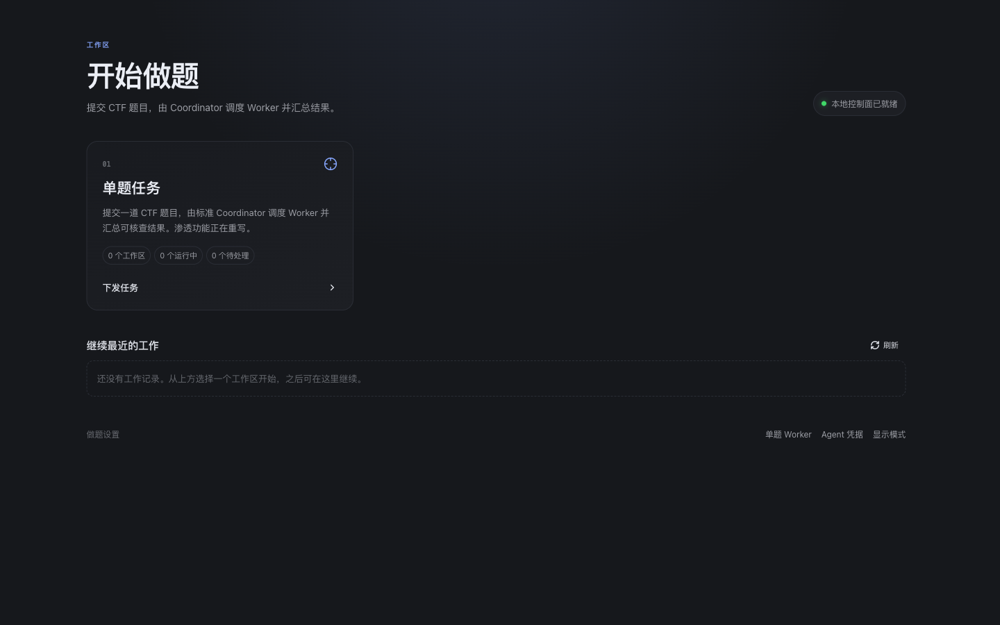
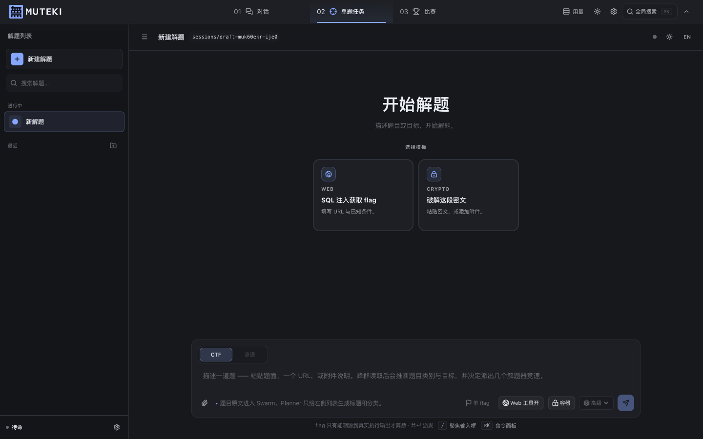
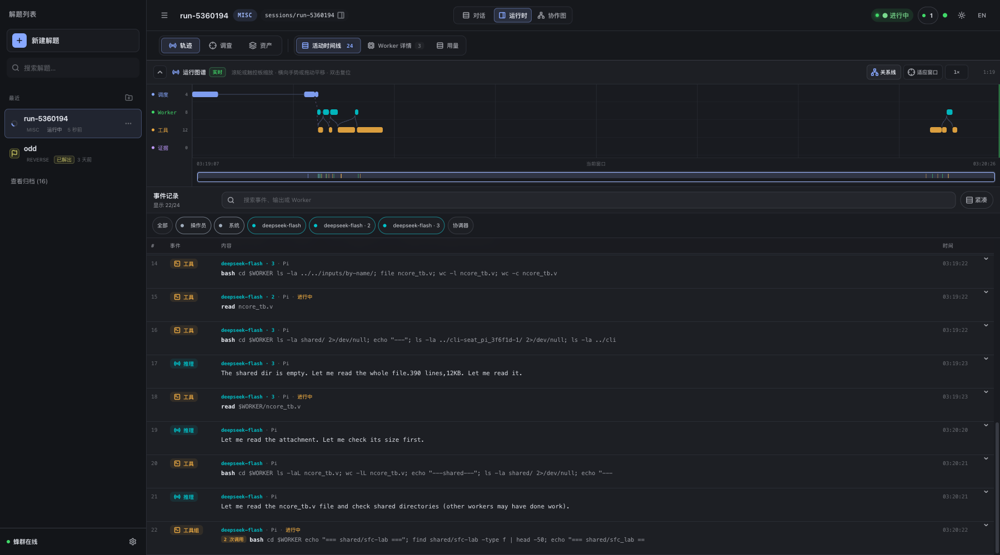

<p align="center">
  <picture>
    <source media="(prefers-color-scheme: dark)" srcset="./assets/logo-dark.png">
    <source media="(prefers-color-scheme: light)" srcset="./assets/logo-light.png">
    
  </picture>
</p>

<h1 align="center">無敵 · Project Muteki</h1>

<p align="center">
  <strong>Heterogeneous Multi-Model AI Agent Swarm · Autonomous Security Automation</strong>
</p>

<p align="center">
  <a href="LICENSE"></a>
  <a href="https://www.rust-lang.org/"></a>
  <a href="https://github.com/FishCodeTech/muteki/stargazers"></a>
  <a href="https://atomgit.com/FishCodeTech/muteki"></a>
  <a href="https://github.com/FishCodeTech/muteki/issues"></a>
  <a href="https://github.com/FishCodeTech/muteki/pulls"></a>
  
  
</p>

<p align="center">
  <strong>English</strong> · <a href="README_CN.md">简体中文</a> · <a href="https://github.com/FishCodeTech/muteki/blob/v0.4.7/CHANGELOG.md">Python changelog</a> · <a href="DISCLAIMER.md">Disclaimer (中文)</a> · <a href="#development">Dev build guide</a>
</p>

<p align="center">
  <a href="https://www.star-history.com/#FishCodeTech/muteki&amp;Date">
    <picture>
      <source media="(prefers-color-scheme: dark)" srcset="https://api.star-history.com/svg?repos=FishCodeTech/muteki&amp;type=Date&amp;theme=dark">
      <source media="(prefers-color-scheme: light)" srcset="https://api.star-history.com/svg?repos=FishCodeTech/muteki&amp;type=Date">
      
    </picture>
  </a>
</p>

---

**無敵 · Project Muteki** is an open-source, multi-agent security framework built with Remix Engineering. A Coordinator schedules different Agent engines toward one goal, manages their context, and lets them collaborate through shared evidence. The current Worker engines are Claude, Codex, Cursor, Pi, OMP, Kimi, Grok, OpenCode, and Droid. The project will keep expanding beyond CTF toward a broader Agent workbench.

> ## ⚠️ Read before running
>
> **Unauthorized attacks against other projects, systems, or networks carried out by third parties using Muteki are their own actions. Those carrying them out bear responsibility for their actions and the consequences. The author and this project disclaim all responsibility and liability for those third-party actions and do not authorize or endorse them.** See the full [disclaimer and unauthorized-use responsibility statement (中文)](DISCLAIMER.md).
>
> Use Muteki only against challenges and targets you own or are authorized to test. Muteki drives CLI Agents that can run commands, invoke security tools, and access target services. **It does not isolate malicious challenges.**
>
> A dedicated disposable VPS, VM, or machine without sensitive data is recommended. Avoid shared hosts and production systems. See [SECURITY.md](SECURITY.md). I often run it directly on my own computer because that is easier to set up, but that does not remove the risk.

---

## What can it do?

At RIFFHACK 2026, Muteki ran for three hours without human takeover, solved every challenge, and placed eighth.


On the iChunQiu Yunjing *blackmaze* penetration-testing range, which had seen no solves for three months, Muteki took first blood in about two hours of actual solving. The platform shows 39 hours because debugging and multi-Flag development were interleaved with that run.


It also cleared the Yunjing badge scenarios and Hack The Box challenges across Insane and Hard difficulty levels. The NYU CTF Bench evaluation reached 200/200; those figures reflect the tested setup and model versions, not a promise about every new challenge.

The TSecBench hosted-mode run with deepseek-flash ranked 13th: [result page](https://tsecbench.zc.tencent.com/agent/22091).


After a month of engineering work, tuning, and fixes, Muteki is open source without a paid tier or private subgroup. Please report problems in Issues and help improve it.

---

## Repositories and versions

| Location | Purpose |
| --- | --- |
| [FishCodeTech/muteki](https://github.com/FishCodeTech/muteki) | Public source, releases and user issues; use this address for sharing, stars and public feedback |
| [AtomGit](https://atomgit.com/FishCodeTech/muteki) | Project mirror; check its actual content for synchronization status |

The current public release is [v0.5.0](https://github.com/FishCodeTech/muteki/releases/tag/v0.5.0). It moves the main application from the Python/FastAPI and Electron stack used by v0.4.7 to the Rust service, Next.js frontend and native macOS shell in this repository.

Existing managed v0.4.7 Web installations can upgrade through the stable command. The updater verifies the compatibility bundle and the platform-specific native package before switching the installation:

```bash
muteki upgrade v0.5.0
```

## Rust development quick start

> **Start with the CTF or penetration-testing workspace.** Both appear on the home page by default. Conversation and competition workspaces are optional and can be enabled in appearance settings as described below.

### 1. Prepare the environment and start the Web app

Install **Node.js 22/npm**, a **stable Rust toolchain with edition 2024 support**, and **sccache**. The repository Cargo wrapper requires sccache. Native build dependencies include a C/C++ toolchain, CMake and pkg-config; Linux also needs OpenSSL development headers. See the platform dependency steps in [the release workflow](.github/workflows/build-packages.yml). For local solving, install and sign in to at least one supported Agent CLI.

```bash
git clone https://github.com/FishCodeTech/muteki.git
cd muteki
npm --prefix apps/frontend ci
node scripts/cargo.mjs build -p muteki-server --release -j 1
npm --prefix apps/frontend run build
node scripts/dev.mjs --web --release --skip-build
```

Open **http://127.0.0.1:3101**. The Rust API defaults to `127.0.0.1:8100`; the frontend proxies API calls. No Python Web service or `uv` environment is needed to start this Rust Web app. First-time compilation can take a while. `Ctrl+C` stops the services started by this command; an already-running service it reused is kept.



### 2. Complete the minimum configuration

1. Click **Single-task Workers** on the home page, or open **Worker settings** from the lower-left corner of the single-task page.
2. Under **Agent credentials**, check an existing CLI login or add a token, API key, or custom Base URL. Use the real connection test.
3. Under **Worker lineup**, enable at least one Worker and bind it to a usable account and model. Run the full self-check or check that Worker individually.
4. Under **Runtime environment**, choose **Local** for host CLIs or **Container** for Docker Workers. Container mode needs a Worker image and injectable credentials.
5. Under **Reasoning models**, select and test a Planner endpoint and model. Configure the Titler if needed.
6. Save the settings and return to **Single task**.

Local mode can reuse an Agent CLI login already available on the host. A container cannot inherit that login automatically; bind an injectable account in the credentials page. To get started quickly, use one CLI that already works in your terminal and select Local mode.


### 3. Submit the first challenge

On **Single task**, enter the challenge name, original description, target URL, known facts, and Flag format. Add attachments with the picker, paste, or drag and drop. Check single versus multiple Flags, Web tools, runtime, and advanced options, then click **Dispatch swarm** (`⌘↵` on Mac). If you leave the category empty, Muteki infers it from the challenge. The first run also prepares a workspace and Workers, so watch the status rather than clicking dispatch repeatedly. Defaults are generally a good starting point.



Only run challenges and targets you own or are authorized to test. Workers can execute commands and access target services.

## Runtime choices and Worker tools

| Runtime | Application and Worker location | Status / setup |
| --- | --- | --- |
| **macOS local** | Rust Web or desktop app; host CLI Workers | Apple silicon build and real model flows exercised; install CLIs and security tools separately |
| **macOS + Docker Desktop** | App on the Mac; Linux Worker containers | Shared/per-Run execution exercised; prepare the curated Worker image and injectable credentials |
| **Linux Web / Compose** | Rust Web plus an independent Runner | Native Ubuntu 24.04 arm64 exercised; native amd64 model execution is not yet certified |
| **Windows** | Use a Linux environment appropriate to your setup | No native Windows desktop package or end-to-end Windows/Docker Desktop acceptance is claimed |

### Curated Kali Worker image

The default Worker recipe contains nine CLIs and a curated CTF/security toolchain, with heavy specialist dependencies in an optional layer. ZCode is not included. To build the local `muteki-worker:latest` image:

```bash
./docker/worker/build.sh
```

This is an optional Docker image build, separate from building the Web app. It downloads dependencies and needs Python 3 for capability generation; Go is used when installed, otherwise the script uses a Go builder container. The release workflow verifies the curated and optional specialist variants on their native architectures. Do not assume an older registry `latest` tag contains the new Rust-compatible image.

### Shared or per-Run containers

A shared pool can execute multiple Runs in one compatible container. Each Run has its own workspace and process lifecycle; stopping one should leave its neighbors running. Per-Run mode uses a separate container for each Run. Shared mode is not an OS security boundary between untrusted tasks; image, network, privileges and credential trust domains determine pool compatibility.

The execution node recommends concurrency from its resources. You can use the recommendation, set manual limits, or explicitly disable scheduling concurrency limits. Disabling this limit does not remove separately configured CPU/memory quotas, task budgets or authorization rules. Excess work queues visibly when limits are enabled. Pausing processes does not release their memory.

### Independent Runner

Web handles task policy and records; the Runner controls Docker and Worker processes. In Compose, only the Runner mounts the Docker socket. Remote Runner registration, authenticated TLS/WSS, file transfer and reconnect logic are implemented; external NAT/VPS and all failure windows are not fully certified. Release workflow results record the package, container and runtime checks performed for each version.

### Remote Runner

Manage remote nodes in **Settings → CTF Worker → Execution nodes**:

1. Turn on the remote node listener, enter a listen address (for example `0.0.0.0:7443`) and the public URL nodes can reach (for example `https://203.0.113.10:7443`), then save. The change applies immediately. On first use Web generates a private CA and a server certificate in its data directory; the public URL's host name or IP is included in the certificate. The page shows the CA fingerprint and offers `ca.pem` for download. A listener configured with `--runner-tls-listen/--runner-tls-cert/--runner-tls-key` can only be changed on the command line and is read-only in the page.
2. Under "Enroll a node", enter a name and lifetime (at most 15 minutes) to create single-use commands. They contain the token and the CA fingerprint, and the Runner trusts only that CA. The commands are shown once; keep them out of shared shell history.
3. On the remote machine (Docker and the same `muteki-server` version are required), run the commands from the page:

   ```bash
   printf '%s' '<token>' | muteki-server runner enroll --state-dir "$HOME/.muteki-runner" \
     --server https://203.0.113.10:7443 --ca-sha256 <fingerprint> --token-file /dev/stdin
   muteki-server runner --remote --state-dir "$HOME/.muteki-runner"
   ```

   If the node reaches Web through a proxy, set `HTTPS_PROXY=http://proxy:port` (HTTP CONNECT proxies only); `NO_PROXY` is honoured. `muteki-server runner status --state-dir ...` prints the local identity, credential expiry and the proxy in use.
4. Once the node is online, select it as the execution node under Runtime; remote nodes run container Workers only. The node list supports drain (no new work; running work continues), activate, credential rotation, revocation and deletion. Each node has its own concurrency settings.
5. After a rotation the page shows an install command once (`muteki-server runner install-credential --state-dir ... --credential-file /dev/stdin`); run it on the node and restart the Runner. A revoked identity cannot be restored: issue a new enrollment token and use `runner enroll ... --replace`.

Workers over a node's concurrency limit queue, and the run page shows them as queued; work for an offline node waits for it to reconnect. Revocation invalidates the node session immediately and is permanent. Turning off "Search tools" when dispatching disables built-in search/fetch for Claude and Codex (Pi has none); other engines refuse to start rather than run with search enabled. This is separate from the container network policy.

## Configuration guide

| Location | What it controls | First action |
| --- | --- | --- |
| **Single-task settings → Agent credentials** | Engine detection, host login, tokens/keys, custom endpoints, connection tests | Confirm at least one usable account; never paste keys into a challenge or commit them |
| **Single-task settings → Worker lineup** | Worker engines, models, reasoning effort, enablement, and per-seat concurrency | Enable one Worker that passes preflight, then add others |
| **Single-task settings → Runtime environment** | Local/container mode, container scope, network, image, optional VPN | Usually keep the default |
| **Single-task settings → Scheduling and budgets** | Automatic versus fixed dispatch, concurrency, time, Worker count, cost cap | Keep defaults initially; set limits when needed |
| **Single-task settings → Reasoning models** | Planner and Titler endpoints, models, generation parameters | Test a real Planner request |
| **Settings → Appearance → Workspace mode** | Visibility of conversation and competition workspaces | Enable them to try the additional workspaces |

**Workers and the Planner are configured separately.** Worker CLIs execute the task. The Planner makes coordination decisions and proposes Steps. Local Workers may reuse host logins, while the Planner needs a working model endpoint. Add a compatible custom endpoint in credentials/model settings, then bind it to the appropriate Worker or Planner. Saving settings affects **future** runs; it does not rebuild a run already in progress.

### Supported Worker engines

The curated Worker registry lists **Claude Code, Codex, Cursor, Pi, OMP, Kimi, Grok, OpenCode and Droid**. Installation versions are defined in [`docker/worker-common/engines.json`](docker/worker-common/engines.json). A listed or installed CLI still needs compatible credentials, a working model and the correct runtime; it is not evidence that every vendor/model combination has been verified.

Configure **Pi + Ollama** by adding an OpenAI-compatible endpoint (for example `http://127.0.0.1:11434/v1` for a host CLI, or `http://host.docker.internal:11434/v1` inside Docker), choosing a model that Ollama actually serves, and testing the connection in the selected environment. A remote Runner needs an endpoint reachable from that node; its `localhost` is not the Web machine. Bind the endpoint/model to the Pi Worker and configure the Planner separately. Save both configurations before starting a task.

If the page says **Needs self-check** or **No usable credential**, test the account, then check the Worker's account, model and runtime binding. Self-check sends a real model request and may incur usage.

### Model price feed

Muteki uses the public [model-prices](https://github.com/jiayuqi7813/model-prices) catalog for usage estimates and caches valid catalog data for 24 hours. Configure mappings and custom rates in **Settings → Agents and endpoints → Model pricing**. Rates use USD per million tokens; an explicit zero rate differs from an unknown price. Missing usage is not fabricated from a price table. Public estimates are not subscription bills or guaranteed relay charges.

## Solving a challenge

### Before dispatch

- **Description:** Provide the original prompt, category, URL or host and port, Flag format, and facts you have verified. Do not present guesses as confirmed facts.
- **Attachments:** Upload challenge files. The run workspace keeps inputs and Worker artifacts for later review.
- **One or several Flags:** A single-Flag run can stop at a qualified candidate. A multi-Flag run keeps collecting; enter the expected count if known, or watch the timeout, budget, and manual stop controls.
- **Web tools:** Control the Agent's WebSearch and WebFetch capabilities so unrelated external searches do not pull it away from the target.
- **Advanced:** Set the Flag format, allow operator-input requests, and bound time, Worker count, and cost for this run. Match the competition's Flag rules.

### During a run: composer and controls

The run page shows Coordinator messages, Worker state, activity, evidence, and candidate Flags. Target all Workers or one Worker from the selector above the composer. Controls change with run state:



| Action | Effect | When to use it |
| --- | --- | --- |
| **Type and press Enter / Send** | Sends a hint to the selected target; **does not create a Step** | Add a clue, correct the challenge text, or share a known result |
| **Dispatch** | Creates a new Step from the input; a URL in the text may update the target | Ask for a specific new direction or action |
| **Ask progress** | Summarizes verified findings, active directions, and blockers in the conversation | Check status without changing the task |
| **Pause / Resume** | Pauses and resumes swarm scheduling | Inspect the challenge or wait for operator input |
| **Freeze / Unfreeze** | Immediately freezes active Workers and releases them later | Stronger intervention in running work |
| **Stop** | Stops this run and its Workers while keeping the record | The target changed, the run should end, or a limit was reached |

A hint differs from Dispatch. Typing “The `/admin` directory is confirmed” and pressing Enter adds information. Clicking Dispatch creates a new Step and may launch a Worker. Avoid repeatedly clicking controls while the run is updating.


If a Worker asks for input, answer in the pending card, provide the needed resource, or reject/correct the request so the run can continue.

### After a Flag or a finished run

- **Copy the Flag and verify it on the challenge platform.**
- **Mark false positive:** If the platform rejects a candidate, mark that specific Flag as a false positive (`×` on its row does the same). For multi-Flag runs, select the candidate first. This reopens solving.
- **Continue solving:** Restart the swarm on the finished run while preserving its existing evidence.
- **Ask / Generate writeup:** Ask the solving Worker a follow-up or generate a report. On success, the report appears in the conversation and in `sessions/<run-id>/writeup.md` under the selected Rust state directory. Generation summarizes the run's full context and can take time.

## Additional workspaces under test

The home page shows only single-task solving by default. In **Settings → Appearance → Workspace mode**, enable **Show conversation and competition modes** to reveal Conversation and Competition on the home page, navigation, and search. These workspaces are still being tested; please report issues.


### Conversation workspace (testing)

Open **Conversation** to work with an external Agent across multiple turns and review tool calls, approvals, artifacts, and history. Configure its Agent runtime, credentials, and permissions under **Settings → Agents** first. Live guidance depends on the connected transport. Its controls are separate from those for a single CTF run.

### Competition workspace (testing)

Create and test a platform connection, then register the remote competition ID. The workspace can sync challenges, schedule single-task runs, inspect candidates, and track remote submission verdicts. CTFd, rCTF, and GZCTF connection options are available; actual capability depends on the probe result. Test account and submission behavior in a practice competition first.

### Custom Agent Plugins (testing)

Open **Settings → Extensions** (or Extensions on the home page when all workspaces are enabled). Sources may be a local directory, archive, Git, HTTP, or Catalog. An extension root needs an **Agent Plugins 1.0.0** `plugin.json`. Generate an install preview, review its source, digest, and permissions, then install. Installed plugins can be enabled, configured, upgraded, rolled back, or removed. Install only extensions you trust.


## Deployment, data and development

### Local Web service

```bash
node scripts/dev.mjs --web --release --skip-build  # Existing production build, UI :3101
node scripts/dev.mjs --hot --web                   # Frontend hot preview, UI :3103
```

`MUTEKI_STATE_DIR` selects the private state root; source development defaults to `.state`. A packaged macOS app uses its application data directory. Credentials and run records belong in private data, not the repository or application bundle. Python state is not automatically converted by changing branches.

For LAN exposure, set an access password, `MUTEKI_WEB_TLS_CERT` and `MUTEKI_WEB_TLS_KEY` to your HTTPS certificate/key paths, then use `node scripts/dev.mjs --web --release --skip-build --host 0.0.0.0`. Configure `MUTEKI_WEB_PASSWORD` in the environment or access settings before exposing the service. Restart a reused backend if its access configuration needs to change. Open the Web UI over HTTPS and trust the issuing CA on clients. The API stays on loopback; direct non-loopback HTTP API binds are rejected.

### Docker Compose

Prepare a **Linux** Web image and a Worker image matching the intended version/architecture. `muteki-web:latest` and `muteki-worker:latest` below are local image names, not a promise that a registry tag is current. The Web image is packaged from a Linux Web release with [`docker/web/Dockerfile`](docker/web/Dockerfile); release packaging is defined in [the workflow](.github/workflows/build-packages.yml).

```bash
MUTEKI_WEB_TLS_CERT=/absolute/path/to/cert.pem \
MUTEKI_WEB_TLS_KEY=/absolute/path/to/key.pem \
MUTEKI_HOST_DATA_ROOT=/opt/muteki/data \
MUTEKI_WEB_IMAGE=muteki-web:latest \
MUTEKI_WORKER_IMAGE=muteki-worker:latest \
MUTEKI_WEB_PASSWORD='replace-with-a-strong-password' \
  docker compose -f docker-compose.web.yml up -d --wait
```

Open `https://127.0.0.1:3101` using a certificate valid for the chosen hostname. Web and Runner share the absolute host data root, while Web has no Docker socket. Drain active Workers before upgrading or rolling back; retain data and the previous image digests. Linux arm64 and Docker Desktop arm64 acceptance do not certify every other platform.

### Development

After installing frontend dependencies, use `node scripts/dev.mjs --hot --web` for browser preview. On macOS, `node scripts/dev.mjs --hot` opens the desktop development window. Frontend updates use port `3103` and `.next-dev`; Rust changes require rebuilding and restarting the backend. Use a separate `MUTEKI_STATE_DIR` when development should not share your normal data.

For a macOS desktop package:

```bash
node scripts/cargo.mjs build --workspace --release -j 1
npm --prefix apps/frontend run build
node scripts/package-macos.mjs --skip-build
```

The output is `dist/Muteki.app`. The package includes Node, the frontend and the Rust service. Current local packages are ad-hoc signed, not Developer ID signed or notarized. Do not assume the older Python release's platform matrix or updater behavior applies to a newly built Rust package.

For a standalone Web release on the target macOS/Linux platform, build the server/frontend as above and run `node scripts/package-web.mjs --skip-build`. The archive is written under `dist/web-releases/`. The old `./init.sh`, `./run.sh`, `ctf-tools/` and Python Ubuntu installer belong to the archived branch.

Native Linux Web releases require compatible glibc and the C++ runtime. On Ubuntu 24.04, install `sudo apt-get install libstdc++6`. Check missing libraries with `ldd bin/muteki-server`. The Web Docker image includes the runtime.

## Troubleshooting

| Symptom | Check first |
| --- | --- |
| Page does not open | The address printed by the launcher; Node/npm, Rust binary, Next build, and terminal error output |
| No usable Worker | CLI installation and login, Agent credential test, enabled Worker lineup, account and model binding |
| Container run fails to start | Docker service, Worker image, container credentials, network/VPN, and Runtime environment settings |
| Planner test fails | Endpoint, model, key/Base URL, and network; a working Worker CLI does not configure the Planner |
| Conversation, Competition, or Extensions missing | Enable their visibility in **Settings → Appearance → Workspace mode** |
| Platform rejects a Flag | Mark that candidate as a false positive, continue solving, and check the challenge text and Flag format |
| Multi-Flag run keeps going | Enter the expected count; otherwise stop manually or use a time/worker/cost limit |

## Project and participation

- **Code map:** `crates/server/` is the Rust API/Runner; `crates/desktop/` is the desktop shell; `apps/frontend/` is Next.js; `cmd/runtime-agent/` manages container processes; `docker/` contains image recipes.
- **Issues:** Report bugs and documentation problems in [GitHub Issues](https://github.com/FishCodeTech/muteki/issues), with reproduction steps, version, and redacted logs. Report security vulnerabilities privately as described in [SECURITY.md](SECURITY.md).
- **License:** [GNU AGPL-3.0](LICENSE). External Agent CLIs and model services have their own licenses, terms, and charges.

## Future work

- Expand native amd64, Windows and external proxy/NAT acceptance coverage.
- Continue improving Pentest and source-code security workflows.
- Extend the integrated Agent chat and plugin ecosystem.
- Verify more failure/recovery windows and cross-version data migrations.

## Contributors

<a href="https://github.com/FishCodeTech/muteki/graphs/contributors">
  
</a>

### Additional development contributor

<table>
  <tr>
    <td align="center" valign="top" width="140">
      <a href="https://github.com/FzWjScJ">
        <br>
        <sub><b>FzWjScJ</b></sub>
      </a><br>
      <sub>Bug reports · Pull requests</sub>
    </td>
  </tr>
</table>

## Acknowledgements

Thanks to [c3](https://github.com/Real-C3ngH) for the Yunjing range account. I used a lot of grit and made plenty of popcorn along the way.

Thanks to [l4n](https://github.com/lancer0rz) for the inspiration; the reviewer brought a major improvement to solving efficiency.

Thanks to [陈橘墨](https://github.com/Randark-JMT) for range resources and writeups used in testing and tuning.

~~Thanks to Sam Altman for not banning my account.~~ It got banned; I will remember his name.

~~Thanks to Dario Amodei for not banning my account.~~ It got banned too; I will remember his name.

## References

This project's design and evaluation drew on the following work:

1. **NYU CTF Bench: A Scalable Open-Source Benchmark Dataset for Evaluating LLMs in Offensive Security** — Minghao Shao, Sofija Jancheska, Meet Udeshi, Brendan Dolan-Gavitt, et al. *NeurIPS 2024 Datasets & Benchmarks Track*. [arXiv:2406.05590](https://arxiv.org/abs/2406.05590)
2. **Teams of LLM Agents can Exploit Zero-Day Vulnerabilities** — Richard Fang, Rohan Bindu, Akul Gupta, Daniel Kang. *EACL 2026*. [Paper](https://aclanthology.org/2026.eacl-long.2.pdf)
3. **D-CIPHER: Dynamic Collaborative Intelligent Multi-Agent System with Planner and Heterogeneous Executors for Offensive Security** — Chenhui Zhang, et al. 2025. [arXiv:2502.10931](https://arxiv.org/abs/2502.10931)
4. **HackSynth: LLM Agent and Evaluation Framework for Autonomous Penetration Testing** — Lajos Muzsai, David Imolai, András Lukács. 2024. [arXiv:2412.01778](https://arxiv.org/abs/2412.01778)
5. **CTFAgent: An LLM-powered Agent for CTF Challenge Solving** — Jiaze Sun, et al. *Computers & Security*, 2025. [ScienceDirect](https://doi.org/10.1016/j.cose.2025.104488)
6. **Co-RedTeam: Orchestrated Security Discovery and Exploitation with LLM Agents** — Jiahao Zhu, et al. 2025. [arXiv:2602.02164](https://arxiv.org/abs/2602.02164)
7. [Related project article](https://mp.weixin.qq.com/s/ZzKF_0MOb0cak9izhHqCUQ)
