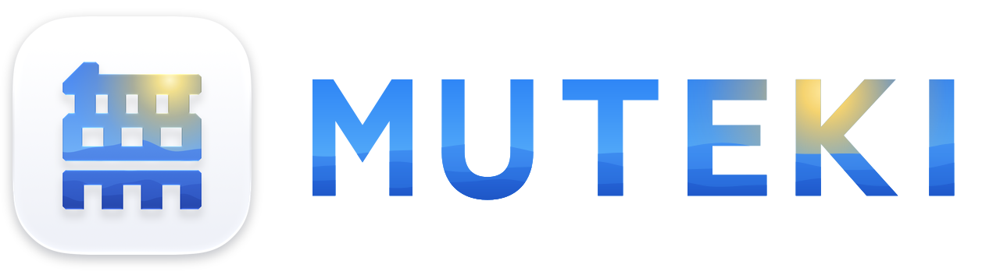

<p align="center">
  <picture>
    <source media="(prefers-color-scheme: dark)" srcset="./assets/logo-dark.png">
    <source media="(prefers-color-scheme: light)" srcset="./assets/logo-light.png">
    
  </picture>
</p>

<h1 align="center">無敵 · Project Muteki</h1>

<p align="center">
  <strong>The open-source control plane for coding agents.</strong>
  <br />
  <strong>Heterogeneous Multi-Model AI Agent Swarm Orchestration</strong>
</p>

<p align="center">
  <a href="https://muteki.codes/en/"></a>
  <a href="LICENSE"></a>
  <a href="https://www.rust-lang.org/"></a>
  <a href="https://github.com/FishCodeTech/muteki/stargazers"></a>
  <a href="https://atomgit.com/FishCodeTech/muteki"></a>
  <a href="https://github.com/FishCodeTech/muteki/issues"></a>
  <a href="https://muteki.codes/en/docs/benchmarks/"></a>
  <a href="https://muteki.codes/en/docs/runtime-and-configuration/"></a>
</p>

<p align="center">
  <strong>English</strong> · <a href="README_CN.md">简体中文</a> · <a href="https://muteki.codes/en/">Website</a> · <a href="https://muteki.codes/en/docs/">Docs</a> · <a href="https://github.com/FishCodeTech/muteki/releases/tag/v0.5.3">Download v0.5.3</a> · <a href="DISCLAIMER.md">Disclaimer (中文)</a> · <a href="CHANGELOG.md">Changelog</a>
</p>

---

**無敵 · Project Muteki** is an open-source control plane for coding agents built with Remix Engineering. Through unified multi-agent scheduling and context coordination, it dispatches tasks automatically, accumulates shared evidence, and manages runtimes, engine credentials, concurrency budgets, and live operator intervention so heterogeneous agents can advance toward one goal like a swarm.

Muteki currently supports major CLI engines including **Claude, Codex, Cursor, Pi, OMP, Kimi, Grok, OpenCode, and Droid**, covering Chat, CTF, Penetration Testing, SRC Bounty, and Competition workspaces, while expanding toward general software engineering and complex collaboration.

- **Website & Full Documentation**: [muteki.codes](https://muteki.codes/en/) · [Documentation Hub](https://muteki.codes/en/docs/) ([Quick Start](https://muteki.codes/en/docs/quick-start/) · [Configuration](https://muteki.codes/en/docs/configuration/) · [Workspaces](https://muteki.codes/en/docs/ctf/) · [Benchmarks](https://muteki.codes/en/docs/benchmarks/))
- **Repository & Feedback**: Official releases and public issues live at [FishCodeTech/muteki](https://github.com/FishCodeTech/muteki) (Mirror: [AtomGit](https://atomgit.com/FishCodeTech/muteki)) · [Changelog](CHANGELOG.md) · [Security](SECURITY.md) · [GNU AGPL-3.0](LICENSE)

> ## ⚠️ Disclaimer & Read Before Running
>
> **Unauthorized attacks against other projects, systems, or networks carried out by third parties using Muteki are their own actions. Those carrying them out bear responsibility for their actions and the consequences. The author and this project disclaim all responsibility and liability for those third-party actions and do not authorize or endorse them.** See the full statement in [DISCLAIMER.md](DISCLAIMER.md) (中文).
>
> Muteki drives CLI Agents that run real commands, invoke tools, and access target services. **It does not isolate malicious challenges or untrusted targets.** For offensive or security tasks, run it in a dedicated, disposable VPS, VM, or isolated machine without sensitive data. Report security vulnerabilities privately via [SECURITY.md](SECURITY.md).

---

## Quick Start

The current public release is **[v0.5.3](https://github.com/FishCodeTech/muteki/releases/tag/v0.5.3)** (Rust service + Next.js frontend + native macOS shell). For full platform selection, Desktop vs. Web comparison, remote access, and Worker/Planner setup, see the **[Installation & Run Guide](https://muteki.codes/en/docs/installation/)**.

### macOS Desktop (Apple Silicon)

Download `Muteki-0.5.3-arm64.zip` from [v0.5.3 Release](https://github.com/FishCodeTech/muteki/releases/tag/v0.5.3), extract it, and drag `Muteki.app` into `/Applications`. Because the release is not yet notarized, if macOS blocks the first launch, go to **System Settings → Privacy & Security** and click **Open Anyway**.

### Standalone Web Archive (Linux / macOS)

Download the matching archive from Releases (for example `Muteki-Web-0.5.3-linux-amd64.tar.gz`, which bundles Node and `muteki-server`), extract, start, and open `http://127.0.0.1:3101`:

```bash
tar -xzf Muteki-Web-0.5.3-linux-amd64.tar.gz
cd muteki-web-0.5.3
MUTEKI_STATE_DIR="$HOME/.muteki-state" ./bin/node ./launcher.mjs web
```

### Docker Compose (Recommended for Servers / Windows WSL2)

```bash
MUTEKI_HOST_DATA_ROOT=/opt/muteki/data \
MUTEKI_WEB_IMAGE=ghcr.io/fishcodetech/muteki-web:v0.5.3 \
MUTEKI_WORKER_IMAGE=ghcr.io/fishcodetech/muteki-worker:v0.5.3 \
MUTEKI_WEB_PASSWORD='replace-with-a-strong-password' \
  docker compose -f docker-compose.release.yml up -d --wait
```

### Run from Source

Requires Node.js 22, a stable Rust toolchain with edition 2024 support, sccache, and standard C/C++ build tools (see [Development Docs](https://muteki.codes/en/docs/development/)):

```bash
git clone https://github.com/FishCodeTech/muteki.git
cd muteki
npm --prefix apps/frontend ci
node scripts/dev.mjs --web
```

> After startup, bind at least one usable CLI Agent credential and a Planner reasoning model in Settings to dispatch your first task. See [Quick Start](https://muteki.codes/en/docs/quick-start/) and [Workers, Runtime & Remote Runners](https://muteki.codes/en/docs/runtime-and-configuration/).

---

## Contributors

<a href="https://github.com/FishCodeTech/muteki/graphs/contributors">
  
</a>

### Additional Development Contributors

> Day-to-day development takes place in an internal private repository and is synced to the public repository on release. Because synced releases cannot preserve full commit attribution for all internal-stage contributors in GitHub's public contributor graph, they are listed here separately.

<table>
  <tr>
    <td align="center" valign="top" width="140">
      <a href="https://github.com/FzWjScJ">
        <br>
        <sub><b>FzWjScJ</b></sub>
      </a>
    </td>
  </tr>
</table>

## Acknowledgements

- Thanks to [c3](https://github.com/Real-C3ngH) for the Yunjing range account — burned plenty of credits and popped plenty of corn along the way.
- Thanks to [l4n](https://github.com/lancer0rz) for the inspiration; the Reviewer brought a major improvement to solving efficiency.
- Thanks to [陈橘墨](https://github.com/Randark-JMT) for range resources and writeups used in extensive testing and tuning.
- ~~Thanks to Sam Altman for not banning my account.~~ It got banned; I will remember his name.
- ~~Thanks to Dario Amodei for not banning my account.~~ It got banned too; I will remember his name.

## Star History

<a href="https://www.star-history.com/#FishCodeTech/muteki&amp;Date">
  <picture>
    <source media="(prefers-color-scheme: dark)" srcset="https://api.star-history.com/svg?repos=FishCodeTech/muteki&amp;type=Date&amp;theme=dark">
    <source media="(prefers-color-scheme: light)" srcset="https://api.star-history.com/svg?repos=FishCodeTech/muteki&amp;type=Date">
    
  </picture>
</a>
