<p align="center">
  <picture>
    <source media="(prefers-color-scheme: dark)" srcset="./assets/logo-dark.png">
    <source media="(prefers-color-scheme: light)" srcset="./assets/logo-light.png">
    
  </picture>
</p>

<h1 align="center">無敵 · Project Muteki</h1>

<p align="center">
  <strong>多模型异构 AI Agent 蜂群 · 自主攻防安全自动化</strong>
</p>

<p align="center">
  <a href="LICENSE"></a>
  <a href="https://www.rust-lang.org/"></a>
  <a href="https://github.com/FishCodeTech/muteki/stargazers"></a>
  <a href="https://atomgit.com/FishCodeTech/muteki"></a>
  <a href="https://github.com/FishCodeTech/muteki/issues"></a>
  <a href="https://github.com/FishCodeTech/muteki/pulls"></a>
  
  
</p>

<p align="center">
  <a href="README.md">English</a> · <strong>简体中文</strong> · <a href="https://github.com/FishCodeTech/muteki/blob/v0.4.7/CHANGELOG.md">Python 更新记录</a> · <a href="DISCLAIMER.md">免责声明</a> · <a href="#开发与打包">开发版编译与更新</a>
</p>

<p align="center">
  <a href="https://www.star-history.com/#FishCodeTech/muteki&amp;Date">
    <picture>
      <source media="(prefers-color-scheme: dark)" srcset="https://api.star-history.com/svg?repos=FishCodeTech/muteki&amp;type=Date&amp;theme=dark">
      <source media="(prefers-color-scheme: light)" srcset="https://api.star-history.com/svg?repos=FishCodeTech/muteki&amp;type=Date">
      
    </picture>
  </a>
</p>

---

**無敵 · Project Muteki** 是一款基于Remix Engineering 的开源 多agent协作网络安全框架。

本项目核心是实现了一套ai agent的调度方案，自动、智能化协调控制每个agent的上下文，像蜂群一样，各有分工，但都是为了完成最终的目标。并且可以兼容市面大部分的agent引擎，用于使用，当前可用 Worker 引擎为 Claude、Codex、Cursor、Pi、OMP、Kimi、Grok、OpenCode、Droid，后续将逐步支持更多引擎。
项目未来将不断更新，成为all in one，而不是局限于单一安全场景，未来将不断迭代升级，成为成熟的开源agent产品。


> ## ⚠️ 运行前必读
>
> **任何第三方利用本项目对其他项目、系统或网络实施未授权攻击，均属其自行实施的行为。相关行为及后果由实施者自行承担，与本人及本项目无关。本人及本项目不为该等第三方行为及其后果承担任何责任，也不提供授权或背书。** 完整说明见 [免责声明与未授权行为责任声明](DISCLAIMER.md)。
>
> Muteki 是**攻击性安全自动化工具**。它驱动 CLI agent 执行命令、调用安全工具、访问目标服务;
> **它不承诺隔离恶意 challenge**。
>
> 推荐**只在专用、可丢弃的环境里运行** —— 专用 VPS、throwaway VM,或无敏感数据的独立机器。不要在
> 你的主力工作机、共享主机或生产环境运行。详见 [SECURITY.md](SECURITY.md)。
>
> 当然我平时都在自己的电脑直接跑，因为配环境比较方便（

---

## 能力如何？

在RIFFHACK2026 3小时全自动无人工接管，速通ak全部题目。获得第八名。

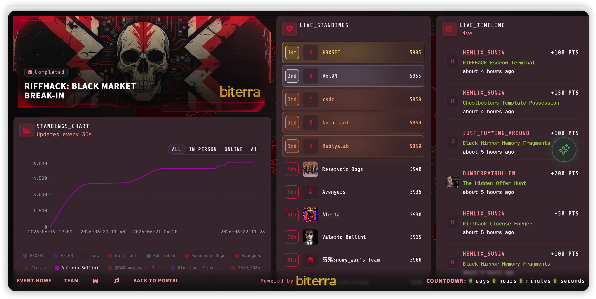

春秋云镜渗透测试靶场blackmaze，三个月0解，muteki 2小时速通一血（为什么平台显示39小时因为期间涉及到各种调试测试多flag的模式支持，所以浪费时间较多，实际解题时间仅花费2小时。）。

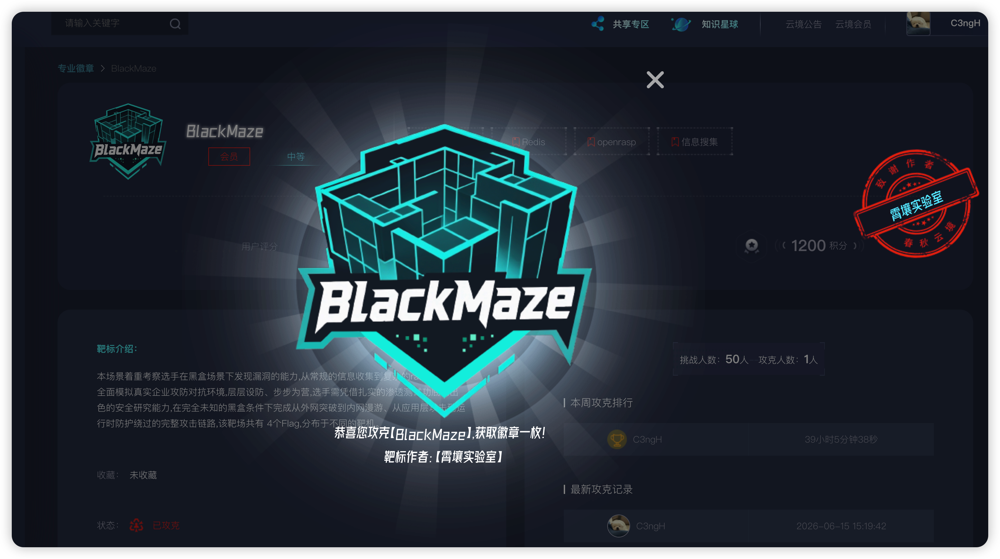

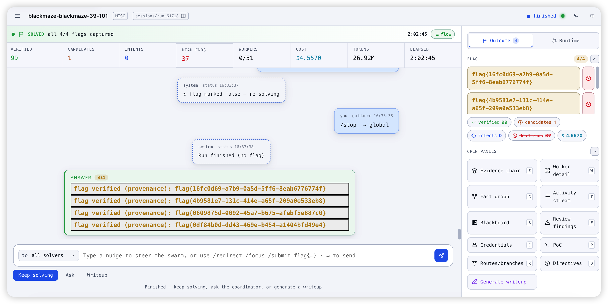

春秋云镜全徽章场景ak。

hackthebox全种类 insane、hard难度ak。

nyuctf benchmark全题目测评成绩，可看文章结尾。

tsecbench 成绩：https://tsecbench.zc.tencent.com/agent/22091

tsecbench 托管模式下+deepseek-flash，排名13

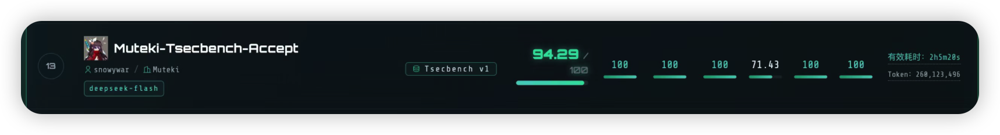

更多你们知道和不知道的各种比赛的一血、高分，均有muteki的身影出现，在此不一一赘述。

总之经过为期一个月的工程化优化，架构能力调教。bug修复，本项目正式开源，没有欺骗star，没有吹逼文案，没有打击你们的自信，没有子群，没有社区，没有骗钱，没有付费，没有营销，直接开源共享。

欢迎使用并一同建设升级，遇到的任何问题请随时提issue，欢迎加入交流群。我们共同建设世界最强的ctf agent。

---

## 项目仓库与版本

| 入口 | 用途 |
| --- | --- |
| [FishCodeTech/muteki](https://github.com/FishCodeTech/muteki) | 公开源码、公开 Release 和用户 Issue；对外分享、Star 和反馈使用此地址 |
| [AtomGit](https://atomgit.com/FishCodeTech/muteki) | 项目镜像；同步情况以镜像实际内容为准 |

当前公开版本为 [v0.5.0](https://github.com/FishCodeTech/muteki/releases/tag/v0.5.0)。主应用已从 v0.4.7 使用的 Python/FastAPI 与 Electron 迁移到本仓库的 Rust 服务、Next.js 前端和 macOS 原生壳。

已有的 v0.4.7 托管 Web 安装可以直接使用稳定命令升级。更新器会校验兼容桥和当前平台的原生发布包，全部通过后才切换安装：

```bash
muteki upgrade v0.5.0
```

## Rust 开发版快速开始

> **从 CTF 或渗透测试工作区开始。** 首页默认显示这两个工作区。对话和比赛工作区可按下文说明，在外观设置中开启。

### 1. 准备环境并启动

准备 **Node.js 22/npm**、**支持 edition 2024 的 stable Rust 工具链**和 **sccache**。仓库的 Cargo 包装脚本要求 sccache。原生构建需要 C/C++ 工具链、CMake、pkg-config 和 dav1d；Linux 还需要 OpenSSL 开发头文件。各平台依赖可参照 [发布工作流](.github/workflows/build-packages.yml)。本地解题还需安装并登录至少一种受支持的 Agent CLI。

```bash
git clone https://github.com/FishCodeTech/muteki.git
cd muteki
npm --prefix apps/frontend ci
node scripts/cargo.mjs build -p muteki-server --release -j 1
npm --prefix apps/frontend run build
node scripts/dev.mjs --web --release --skip-build
```

打开 **http://127.0.0.1:3101**。Rust API 默认监听 `127.0.0.1:8100`，前端代理 API 请求。启动这份 Rust Web 应用不需要 Python Web 服务或 uv 环境。首次编译可能较久，以终端输出为准。`Ctrl+C` 只停止本次启动的服务，复用的已有服务会保留。

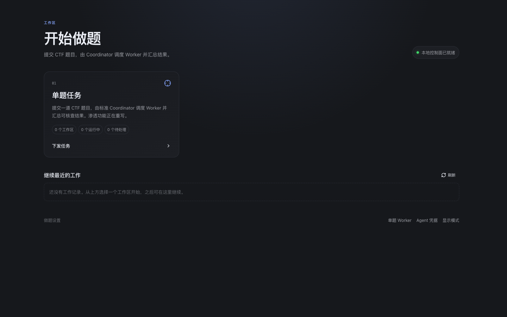

### 2. 完成最小配置

1. 在首页点“单题 Worker”，或进入单题页面后点左下角“Worker 设置”。
2. 在“Agent 凭据”中确认已有的 CLI 登录可用，或新增 Token、API Key、自定义 Base URL 等凭据；使用接入方式标题行上的“测试”做真实连通测试。
3. 回到“出战配置”，选择至少一个已启用的 Worker，为它绑定可用凭据和模型；点“一键检查”或单独自检。
4. 在“运行环境”中选“本地运行”（使用宿主机 CLI）或“容器运行”（需要 Docker、Worker 镜像及可注入凭据）。
5. 在“推理模型”中为 Planner 选择模型端点和端点模型，并运行页面提供的测试；按需配置 Titler。
6. 点右上角“保存配置”，再返回“单题任务”开始做题。

本地运行可继承 CLI 已有的宿主登录；容器运行不能直接继承宿主登录，需在凭据页绑定可注入凭据。若只想尽快跑通，先选一个已能在终端正常调用的 CLI 与“本地运行”。

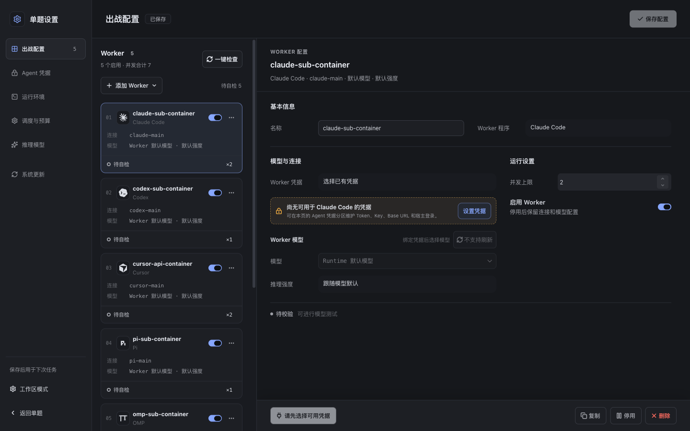

### 3. 提交第一道题

进入“单题任务”，把**题目名称、原文、目标地址、已知条件和 Flag 格式**写进输入框；附件可通过按钮、粘贴或拖拽加入。检查单/多 Flag、Web 工具、运行环境及“高级”选项后，点“派发蜂群”（Mac 可用 `⌘↵`）。没有指定类别时，系统会根据题面推断。首次运行还需准备工作区与 Worker，请等待状态变化。一般默认即可。

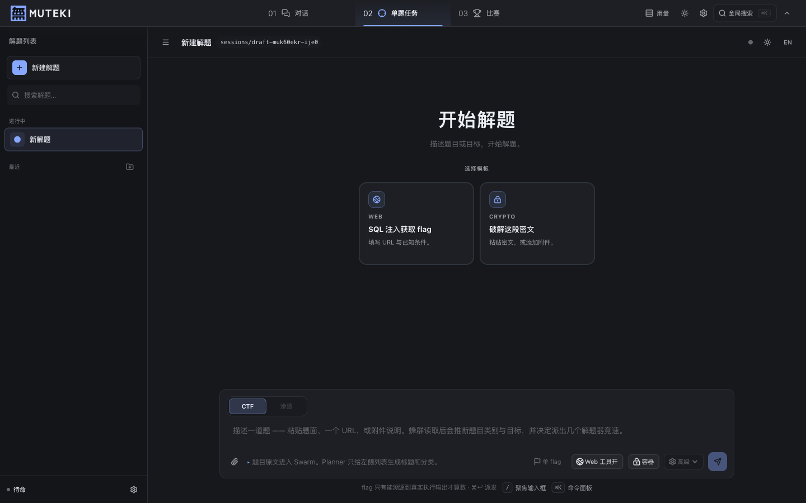

> 只对你拥有或获授权的题目与目标运行。Worker 可以执行命令并访问目标服务。

## 运行方式与 Worker 工具

| 运行方式 | 应用与 Worker 所在位置 | 当前状态 / 准备工作 |
| --- | --- | --- |
| **macOS 本地** | Rust Web 或桌面应用；Worker 使用宿主 CLI | Apple silicon 构建及真实模型流程已验证；CLI 与安全工具自行安装 |
| **macOS + Docker Desktop** | 应用在 Mac，Worker 在 Linux 容器 | 共享/独立容器流程已验证；准备精选 Worker 镜像和可注入凭据 |
| **Linux Web / Compose** | Rust Web 与独立 Runner | Ubuntu 24.04 原生 arm64 已实测；原生 amd64 模型执行尚未认证 |
| **Windows** | 根据实际环境部署 Linux 执行环境 | 不声明已有原生 Windows 桌面包，也不声明 Windows/Docker Desktop 已全流程实测 |

### 精选 Kali Worker 镜像

默认镜像包含九个 CLI 和精选 CTF/安全工具，专科重型依赖作为可选扩展层。镜像不包含 ZCode。构建本地 `muteki-worker:latest`：

```bash
./docker/worker/build.sh
```

这是可选的 Docker 镜像构建，与 Web 应用编译分开，会下载依赖。构建脚本需要 Python 3 生成能力清单；本机有 Go 时使用 Go，否则使用 Go 构建容器。发布工作流会在原生架构上验证精选镜像和可选专科镜像。不要直接把旧仓库的 `latest` 标签当成新的 Rust 配套镜像。

### 一个容器多 Run，或者每 Run 一个容器

共享模式让多个 Run 使用兼容的同一容器，各自维护工作区和进程生命周期，停止一个 Run 不应影响邻居。独立模式为每个 Run 分配单独容器。共享模式不构成不可信任务之间的操作系统安全隔离；镜像、网络、权限和凭据信任域决定能否进入同一共享池。

并发数量由实际执行节点根据资源给出推荐值。可以采用推荐、手动设置，或明确关闭调度并发限制；关闭不会取消另设的 CPU/内存配额、任务预算或授权约束。启用限制时，超额任务进入可见队列。暂停进程不等于释放内存。

### 独立 Runner

Web 负责任务策略和记录，Runner 控制 Docker 和 Worker 进程。Compose 中只有 Runner 挂载 Docker socket。远程注册、认证 TLS/WSS、文件传输及重连逻辑已实现；外部 NAT/VPS 和全部故障窗口仍未完整认证。各版本实际执行的原生包、容器和运行时检查以 Release 工作流结果为准。

### 远程 Runner

在 **设置 → CTF Worker → 执行节点** 中管理远程节点：

1. 打开“远程节点监听”，填写监听地址（如 `0.0.0.0:7443`）和节点能访问到的公开地址（如 `https://203.0.113.10:7443`），保存后立即生效。首次启用时 Web 在数据目录生成私有 CA 和服务端证书；公开地址的主机名或 IP 会写入证书。页面显示 CA 指纹，也可下载 `ca.pem`。用启动参数 `--runner-tls-listen/--runner-tls-cert/--runner-tls-key` 配置的监听只能在命令行修改，页面只读。
2. 在“注册新节点”中填写名称和有效期（最长 15 分钟），生成一次性注册命令。命令带有令牌和 CA 指纹，Runner 只信任这一 CA；命令只显示一次，不要写进共享的 shell 历史。
3. 在远程机器上（需要 Docker 和同版本的 `muteki-server`）依次执行页面给出的命令：

   ```bash
   printf '%s' '<token>' | muteki-server runner enroll --state-dir "$HOME/.muteki-runner" \
     --server https://203.0.113.10:7443 --ca-sha256 <fingerprint> --token-file /dev/stdin
   muteki-server runner --remote --state-dir "$HOME/.muteki-runner"
   ```

   节点需要经代理访问 Web 时设置 `HTTPS_PROXY=http://proxy:port`（只支持 HTTP CONNECT 代理），`NO_PROXY` 生效。`muteki-server runner status --state-dir ...` 显示本机身份、凭据到期时间和实际使用的代理。
4. 节点上线后，在“运行环境”中选择它作为执行节点；远程节点只能运行容器 Worker。节点列表可排空（不再接新任务，已在运行的继续）、恢复、轮换凭据、撤销和删除。每个节点有独立的并发设置。
5. 轮换凭据后页面只显示一次安装命令（`muteki-server runner install-credential --state-dir ... --credential-file /dev/stdin`），在节点上执行后重启 Runner。撤销后旧身份无法恢复，重新生成注册令牌后用 `runner enroll ... --replace` 替换。

超过节点并发上限的 Worker 会排队，运行页显示排队状态；节点离线时任务等待它重新上线。撤销立即使节点会话失效，且不可恢复。发任务时关闭“搜索工具”会对 Claude、Codex 禁用内置搜索/抓取（Pi 本身没有），其他引擎会拒绝启动而不是带着搜索工具运行；这与容器网络策略无关。

## 配置详情说明

| 位置 | 主要内容 | 建议的首次操作 |
| --- | --- | --- |
| **单题设置 → Agent 凭据** | 引擎探测、宿主登录、Token/Key、自定义端点、连接测试 | 确认至少一个可用凭据；不要把密钥写入题面或提交到 Git |
| **单题设置 → 出战配置** | Worker 阵容、引擎、模型、推理强度、启停和每席并发 | 先启用一名可自检通过的 Worker，再逐步增加 |
| **单题设置 → 运行环境** | 本地/容器、容器作用域、网络、镜像及可选 VPN | 选择本地 CLI 或容器；容器需镜像和可注入凭据 |
| **单题设置 → 调度与预算** | 自动调度/固定并跑、并发、总时长、Worker 数和成本上限 | 先保留默认值；明确资源限制后再调整 |
| **单题设置 → 推理模型** | Planner、Titler 的端点、模型和生成参数 | 至少测试 Planner 的真实请求 |
| **设置 → 外观配色 → 工作区模式** | 是否显示对话和比赛 | 要试用扩展工作区时开启“显示对话和比赛模式” |

**Worker 和 Planner 是两类配置。** Worker CLI 负责实际解题；Planner 负责协调决策、规划步骤和生成任务列表信息。Worker 凭据可在本地复用宿主登录，Planner 则需选到可用的模型端点。自定义兼容端点可以在凭据/模型端点界面添加，随后分别绑定到需要它的 Worker 或 Planner。设置页的“保存配置”用于**下次**任务；正在运行的题目不会因改设置而自动重建。

### 受支持的 Worker 引擎

精选 Worker 注册表列出 **Claude Code、Codex、Cursor、Pi、OMP、Kimi、Grok、OpenCode、Droid** 九个 CLI，安装版本以 [`docker/worker-common/engines.json`](docker/worker-common/engines.json) 为准。已经登记或安装 CLI，不等于所有厂商/模型组合均已验证；仍需要兼容凭据、可用模型与正确运行环境。

使用 **Pi + Ollama** 时，添加兼容 OpenAI 的端点（例如宿主 CLI 使用 `http://127.0.0.1:11434/v1`，Docker 内使用 `http://host.docker.internal:11434/v1`），选择 Ollama 实际提供的模型，并在所选环境中测试连接。远程 Runner 要填写该节点能访问的地址，它的 localhost 不是 Web 所在机器。将端点/模型绑定到 Pi Worker，并单独配置 Planner，保存后再发起任务。

页面显示“待自检”或“没有可用凭据”时，先测试账号，再检查 Worker 的凭据、模型和运行环境绑定。自检会发起真实模型请求，可能产生用量。

### 模型价格表

Muteki 使用公开的 [model-prices](https://github.com/jiayuqi7813/model-prices) 目录估算用量，缓存有效目录数据 24 小时。可在 **设置 → Agents 和接入点 → 模型价格** 中配置映射与自定义价格。单位为 USD / 百万 Token；明确零价和未知价格是两种状态，价格表不会补造缺失用量。公开标价估算不等于订阅账单或中转商实际收费。

## 如何做题

### 派发前

- **题面：**尽量提供原文、题目类型、URL/主机端口、Flag 形式，以及你已验证的事实。不要把推测写成已验证结论。
- **附件：**可上传题目文件；运行工作区会保存输入和 Worker 产物，便于后续复盘。
- **单 Flag / 多 Flag：**单 Flag 在取得合格候选后可结束。多 Flag 会继续收集；知道数量就填收集总数，不填时需要留意超时、预算或手动停止。
- **Web 工具：**用于控制 Agent 的 WebSearch、WebFetch 功能，防止agent主动搜索外部内容导致目标偏移。
- **高级：**按题目指定 Flag 格式、允许 Worker 请求人工输入，以及本次运行的时长、Worker 总数和成本预算。格式建议与比赛规则一致。

### 运行中：对话输入框和按钮

运行页可查看协调器消息、Worker 状态、活动记录、证据与候选 Flag。输入框上方可选择“全部解题器”或单个 Worker 作为目标。按钮会随运行状态变化：

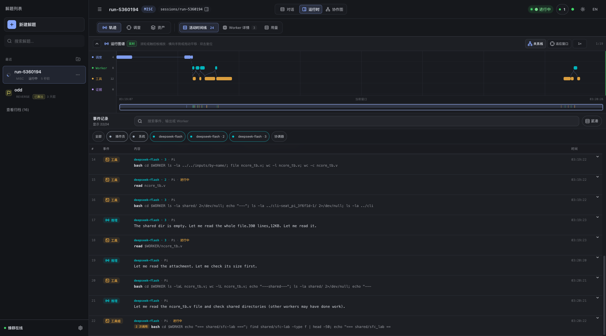

| 操作 | 作用 | 什么时候用 |
| --- | --- | --- |
| **直接输入并回车 / 发送** | 把文字作为“提示”传给所选目标，**不新建 Step** | 补充线索、纠正题面、告诉 Worker 已知结果 |
| **下达** | 将输入原文建成下一步；正文中的 URL 可能更新目标 | 明确要求尝试一个新方向或指定步骤 |
| **询问进展** | 汇总已确认结果、正在验证的方向和阻塞项到对话 | 想了解当前状态又不想改动任务 |
| **暂停 / 继续** | 暂停蜂群调度，再恢复运行 | 需要临时检查题目或等待人工信息 |
| **冻结 / 解冻** | 立即冻结正在执行的 Worker，再放行 | 需要更强的即时干预时 |
| **停止** | 结束本次运行并停止 Worker，保留记录 | 目标已变、运行不应继续或达到人工判断的上限 |

“提示”与“下达”不同：例如输入“目录 `/admin` 已确认存在”，直接回车是补充线索；点击“下达”则会把这句话作为新step提交，会新建worker去执行任务，比较适合目标明确的情况。运行中不要反复点击控制按钮，否则会出现问题。

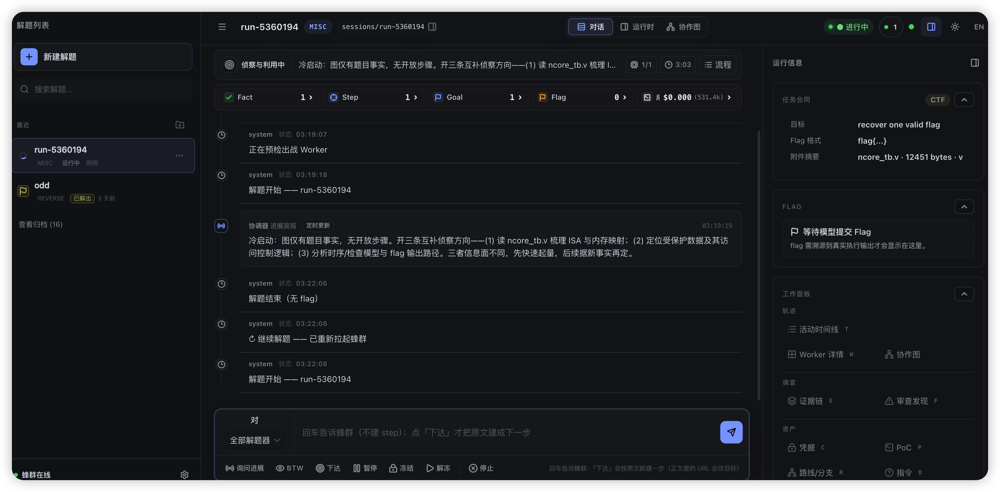

如果 Worker 暂停并向你索取输入，在待处理卡片中回答、提供资源，或选择相应的拒绝/误报处理，让运行继续。

### 出现 Flag 或运行结束后

- **复制 Flag 并到题目平台验证。**
- **标记误报：**如果候选 Flag 被平台判错，在结果区用“标记误报”（单个 Flag 行上的 `×` 也有此作用）。多 Flag 时先选择要否定的那个。此操作会标记候选并重新打开解题。
- **继续做题：**在已结束页面重新拉起完整蜂群，沿用已有证据继续探索。
- **追问 / 生成复盘：**结束后可向解题 Worker 追问，或生成复盘报告。生成成功后，正文会显示在对话中，同时写入所选 Rust 数据目录下该 Run 的 `sessions/<run-id>/writeup.md`。生成会调用实际整个run的全部上下文进行总结。所以会需要一些时间。

## 测试中的扩展功能

默认首页只显示做题模式；在 **设置 → 外观配色 → 工作区模式** 打开“显示对话和比赛模式”后，首页、导航和搜索会出现“对话”“比赛”。默认关闭。
后续muteki的目标是建设成为一个ai native的融合产品。目前该功能为测试阶段，可能bug较多，如有问题随时反馈。

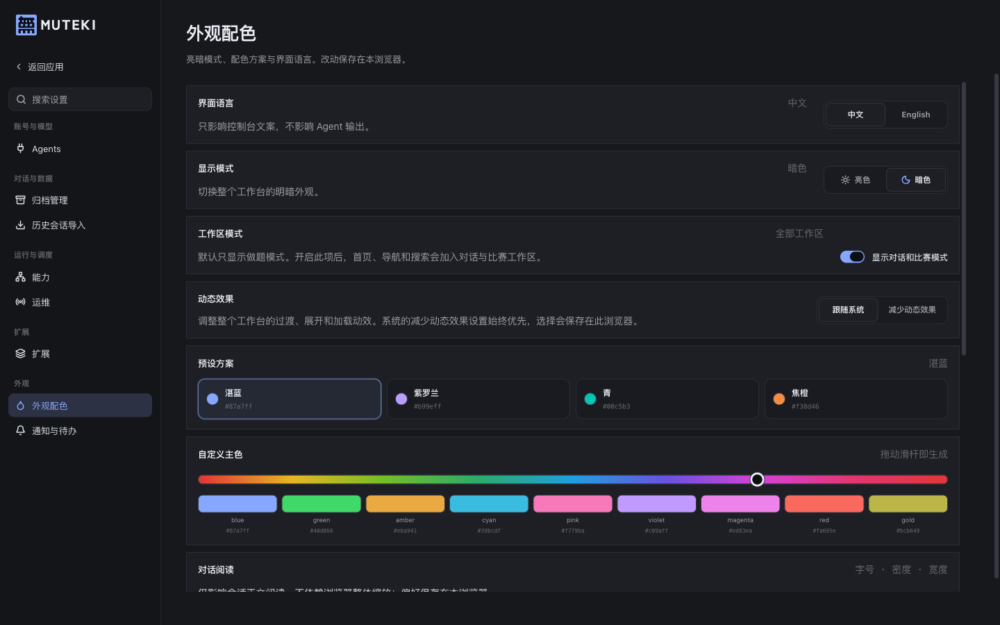

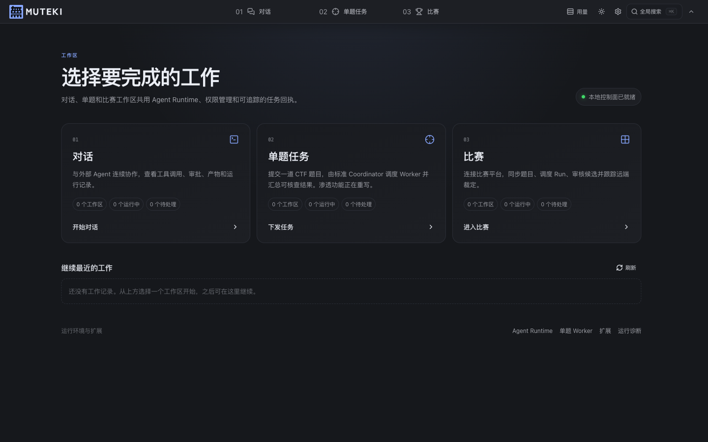

### 对话工作区（测试中）

从首页进入“对话”，可与外部 Agent 连续协作，并查看工具调用、审批、产物及运行记录。需要先在“设置 → Agents”配置相应 Agent Runtime、凭据和权限。对话中的“引导”取决于接入方式是否支持；若按钮不可用，以页面提示为准。此工作区与 CTF 单题运行的控制按钮不同。

### 比赛工作区（测试中）

从首页进入“比赛”，先建立平台连接并测试，再登记远端比赛 ID。进入比赛工作区后，可同步题目、调度单题 Run、检查候选和跟踪远端提交裁定。页面提供 CTFd、rCTF、GZCTF 等平台连接选项；实际可用能力由连接探测结果决定。涉及平台账号或提交行为时，先在测试比赛中验证流程。

### 自定义 Agent Plugin（测试中）

进入 **设置 → 扩展**（启用全部工作区后可从首页“扩展”直达）。这里可从本地目录、归档、Git、HTTP 或 Catalog 指定来源；扩展根目录需有符合 **Agent Plugins 1.0.0** 的 `plugin.json`。先点“生成安装预览”，检查来源、摘要和权限，再执行安装。已安装插件可在此启用、配置、升级、回滚或卸载。只安装你信任的扩展，插件能力以其 manifest 和安装预览为准。

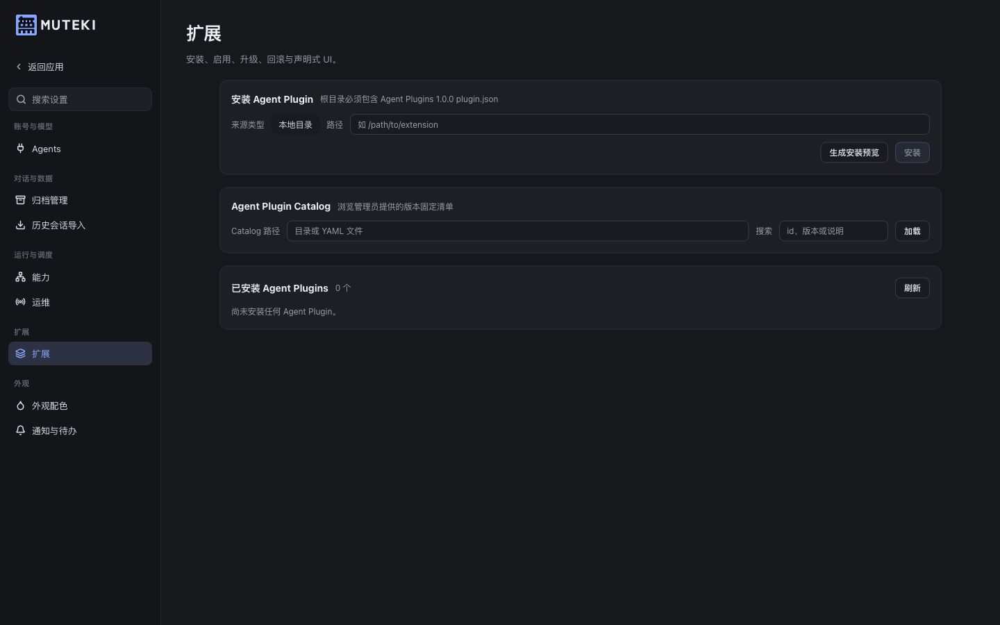

## 部署、数据与开发

### 本地 Web

```bash
node scripts/dev.mjs --web --release --skip-build  # 使用已有生产构建，UI :3101
node scripts/dev.mjs --hot --web                   # 前端热预览，UI :3103
```

`MUTEKI_STATE_DIR` 指定私有状态根目录，源码开发默认使用 `.state`，macOS 安装包使用应用数据目录。凭据与任务记录应保存在私有数据中，不放进仓库或应用包。切换代码分支不会自动转换 Python 运行数据。

需要局域网访问时，先在环境变量或访问设置中配置 `MUTEKI_WEB_PASSWORD`，再用 `node scripts/dev.mjs --web --release --skip-build --host 0.0.0.0` 启动。如果复用了旧后端，需要在访问配置变化后重启它；此方式的 API 仍保留在 loopback。

### Docker Compose

先准备与版本/架构对应的 **Linux Web 镜像**和 Worker 镜像。下例中的 `muteki-web:latest`、`muteki-worker:latest` 是本地镜像名，不表示远程 registry 中的同名标签已更新。Web 镜像使用 Linux Web 发布包和 [`docker/web/Dockerfile`](docker/web/Dockerfile) 构建；发布包流程见 [工作流](.github/workflows/build-packages.yml)。

```bash
MUTEKI_HOST_DATA_ROOT=/opt/muteki/data \
MUTEKI_WEB_IMAGE=muteki-web:latest \
MUTEKI_WORKER_IMAGE=muteki-worker:latest \
MUTEKI_WEB_PASSWORD='replace-with-a-strong-password' \
  docker compose -f docker-compose.web.yml up -d --wait
```

打开 `http://127.0.0.1:3101`。Web 与 Runner 共享绝对路径的数据根，Web 不持有 Docker socket。升级或回滚前先排空活动 Worker，保留数据及旧镜像 digest。原生 Linux arm64 和 Docker Desktop arm64 的实测不能代替其他平台验收。

### 开发与打包

安装前端依赖后，浏览器热预览使用 `node scripts/dev.mjs --hot --web`；macOS 的 `node scripts/dev.mjs --hot` 会打开桌面开发窗口。前端热更新使用 `3103` 和 `.next-dev`，修改 Rust 仍需重新构建并重启后端。开发数据需要隔离时，设置独立的 `MUTEKI_STATE_DIR`。

macOS 桌面打包：

```bash
node scripts/cargo.mjs build --workspace --release -j 1
npm --prefix apps/frontend run build
node scripts/package-macos.mjs --skip-build
```

产物为 `dist/Muteki.app`，包含 Node、前端与 Rust 服务。当前本地包使用 ad-hoc 签名，未经过 Developer ID 签名或公证。不能把旧 Python Release 的平台支持或更新行为直接套到新构建的 Rust 包。

在对应 macOS/Linux 目标平台按前文构建服务和前端后，运行 `node scripts/package-web.mjs --skip-build` 可生成独立 Web 发布包，输出在 `dist/web-releases/`。旧 `./init.sh`、`./run.sh`、`ctf-tools/` 和 Python Ubuntu 安装器属于归档分支。

Linux 原生 Web 发布包依赖系统共享库。在 Ubuntu 24.04 上先安装 `sudo apt-get install libdav1d7 libstdc++6`；其他发行版需提供兼容的 glibc、dav1d 和 C++ 运行库。可用 `ldd bin/muteki-server` 检查缺失项。Web Docker 镜像已安装这些运行库。

## 常见问题

| 现象 | 先检查什么 |
| --- | --- |
| 页面打不开 | 启动器打印的地址、Node/npm、Rust 可执行文件、Next 构建和终端错误输出 |
| 找不到可用 Worker | 确认 CLI 已安装并登录，Agent 凭据测试通过；检查 Worker 是否启用、绑定了正确凭据和模型 |
| 容器任务启动失败 | 检查 Docker 服务、Worker 镜像、容器凭据、网络/VPN 和页面“运行环境”状态 |
| Planner 测试失败 | 核对模型端点、端点模型、Key/Base URL 和网络；Worker CLI 可用不代表 Planner 已配置 |
| 看不到对话、比赛或扩展入口 | 在“设置 → 外观配色 → 工作区模式”开启“显示对话和比赛模式” |
| Flag 在平台被判错 | 在结果区标记对应候选为误报，再看继续解题结果；必要时核对题面和 Flag 格式 |
| 多 Flag 任务一直运行 | 检查是否填写收集总数；未指定数量时，达到目标前可能需要手动停止或由预算上限结束 |

## 项目与参与

- **代码导航：**`crates/server/` 为 Rust API/Runner，`crates/desktop/` 为桌面壳，`apps/frontend/` 为 Next.js，`cmd/runtime-agent/` 管理容器进程，`docker/` 为镜像配方。
- **问题反馈：**功能缺陷和文档问题请到 [GitHub Issues](https://github.com/FishCodeTech/muteki/issues) 提交复现步骤、版本和已脱敏日志。安全漏洞请按 [SECURITY.md](SECURITY.md) 通过私密渠道报告。
- **许可证：**本项目以 [GNU AGPL-3.0](LICENSE) 发布。外部 Agent CLI 和模型服务分别适用其自身的许可、服务条款与费用规则。

## 后续建设

- 补充原生 amd64、Windows 及外部代理/NAT 环境的验收。
- 继续完善渗透测试与源代码安全工作流。
- 扩展融合 Agent 对话和插件生态。
- 补齐更多故障恢复窗口与跨版本数据迁移验证。

## 贡献者

<a href="https://github.com/FishCodeTech/muteki/graphs/contributors">
  
</a>

### 开发阶段补充贡献者

<table>
  <tr>
    <td align="center" valign="top" width="140">
      <a href="https://github.com/FzWjScJ">
        <br>
        <sub><b>FzWjScJ</b></sub>
      </a><br>
      <sub>Bug 反馈 · Pull Request</sub>
    </td>
  </tr>
</table>

## 鸣谢

感谢 [c3](https://github.com/Real-C3ngH) 提供的云镜靶场账号，浪费了很多沙砾，疯狂爆米。

感谢 [l4n](https://github.com/lancer0rz) 师傅提供的灵感，新增的reviwer让整体的解题效率有了质的提升。

感谢 [陈橘墨](https://github.com/Randark-JMT) 师傅提供的靶场资源和writeup，用于大量测试和精调。

~~感谢山姆奥特曼 不封我号~~ 现在已经被封了，我将永远记住他的名字。

~~感谢Dario Amodei 不封我号~~ 现在已经被封了，我将永远记住他的名字。

## 参考文献

本项目的设计和评测参考了以下学术工作:

1. **NYU CTF Bench: A Scalable Open-Source Benchmark Dataset for Evaluating LLMs in Offensive Security**
   Minghao Shao, Sofija Jancheska, Meet Udeshi, Brendan Dolan-Gavitt, et al. *NeurIPS 2024 Datasets & Benchmarks Track*. [arXiv:2406.05590](https://arxiv.org/abs/2406.05590)
2. **Teams of LLM Agents can Exploit Zero-Day Vulnerabilities**
   Richard Fang, Rohan Bindu, Akul Gupta, Daniel Kang. *EACL 2026*. [Paper](https://aclanthology.org/2026.eacl-long.2.pdf)
3. **D-CIPHER: Dynamic Collaborative Intelligent Multi-Agent System with Planner and Heterogeneous Executors for Offensive Security**
   Chenhui Zhang, et al. 2025. [arXiv:2502.10931](https://arxiv.org/abs/2502.10931)
4. **HackSynth: LLM Agent and Evaluation Framework for Autonomous Penetration Testing**
   Lajos Muzsai, David Imolai, András Lukács. 2024. [arXiv:2412.01778](https://arxiv.org/abs/2412.01778)
5. **CTFAgent: An LLM-powered Agent for CTF Challenge Solving**
   Jiaze Sun, et al. *Computers & Security*, 2025. [ScienceDirect](https://doi.org/10.1016/j.cose.2025.104488)
6. **Co-RedTeam: Orchestrated Security Discovery and Exploitation with LLM Agents**
   Jiahao Zhu, et al. 2025. [arXiv:2602.02164](https://arxiv.org/abs/2602.02164)
7. https://mp.weixin.qq.com/s/ZzKF_0MOb0cak9izhHqCUQ
