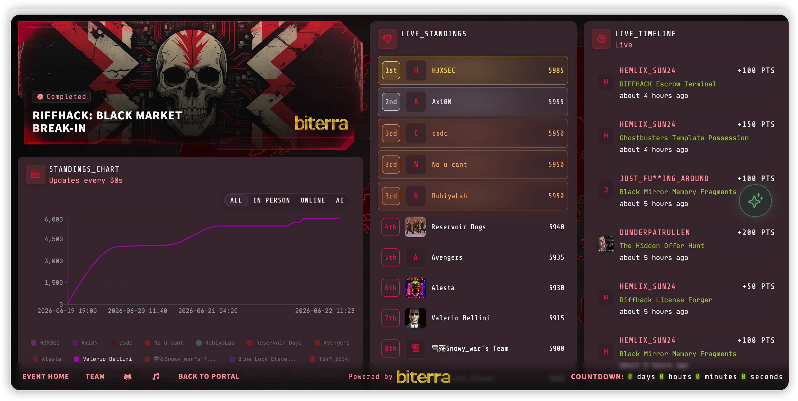
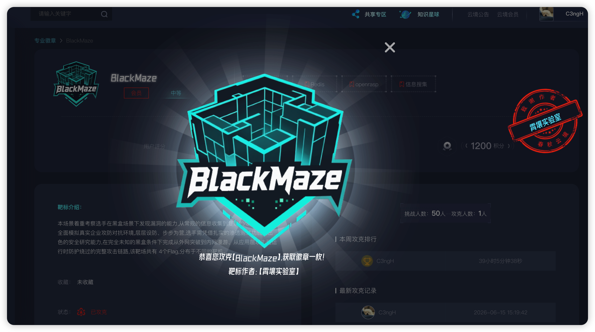
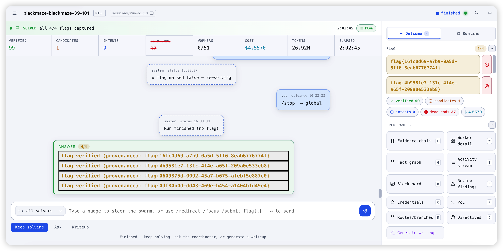
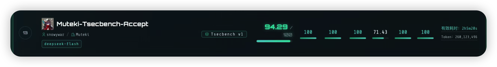

# 实战成绩与评测记录

> 返回：[简体中文 README](../README_CN.md) · [English README](../README.md)

安全攻防是 **無敵 · Project Muteki** 首个经过高强度实战检验的场景。以下记录整理自真实比赛、靶场与公开基准测试，反映当时测试环境与模型版本下的实测表现，不对未测试的新题目或新环境作保证。

## 真实赛事与靶场记录

### RIFFHACK 2026

3 小时全自动无人工接管，速通 AK 全部题目，获得第八名。

### 春秋云镜 · `blackmaze` 渗透测试靶场

三个月 0 解的渗透测试靶场 `blackmaze`，Muteki 在实际约 2 小时解题时间内拿下首杀（平台显示 39 小时系测试期间穿插调试与多 Flag 模式开发所致）。

### 更多实战覆盖

- **春秋云镜**：全徽章场景 AK。
- **Hack The Box**：全种类 Insane、Hard 难度题目 AK。
- **NYU CTF Bench（Python 版）**：200 / 200 全部解出。
- **TSecBench**：托管模式下配合 `deepseek-flash` 排名第 13，详情见 [TSecBench 成绩页](https://tsecbench.zc.tencent.com/agent/22091)。

更多公开与非公开赛事中的一血和高分表现不再逐一列举。Muteki 坚持直接开源共享——没有付费分级、没有子群门槛，欢迎在 [GitHub Issues](https://github.com/FishCodeTech/muteki/issues) 反馈问题或共同建设。

---

## 相关文章与参考文献

- [相关项目介绍文章](https://mp.weixin.qq.com/s/ZzKF_0MOb0cak9izhHqCUQ)

本项目的设计和评测参考了以下学术工作：

1. **NYU CTF Bench: A Scalable Open-Source Benchmark Dataset for Evaluating LLMs in Offensive Security**
   Minghao Shao, Sofija Jancheska, Meet Udeshi, Brendan Dolan-Gavitt, et al. *NeurIPS 2024 Datasets & Benchmarks Track*. [arXiv:2406.05590](https://arxiv.org/abs/2406.05590)
2. **Teams of LLM Agents can Exploit Zero-Day Vulnerabilities**
   Richard Fang, Rohan Bindu, Akul Gupta, Daniel Kang. *EACL 2026*. [Paper](https://aclanthology.org/2026.eacl-long.2.pdf)
3. **D-CIPHER: Dynamic Collaborative Intelligent Multi-Agent System with Planner and Heterogeneous Executors for Offensive Security**
   Chenhui Zhang, et al. 2025. [arXiv:2502.10931](https://arxiv.org/abs/2502.10931)
4. **HackSynth: LLM Agent and Evaluation Framework for Autonomous Penetration Testing**
   Lajos Muzsai, David Imolai, András Lukács. 2024. [arXiv:2412.01778](https://arxiv.org/abs/2412.01778)
5. **CTFAgent: An LLM-powered Agent for CTF Challenge Solving**
   Jiaze Sun, et al. *Computers & Security*, 2025. [ScienceDirect](https://doi.org/10.1016/j.cose.2025.104488)
6. **Co-RedTeam: Orchestrated Security Discovery and Exploitation with LLM Agents**
   Jiahao Zhu, et al. 2025. [arXiv:2602.02164](https://arxiv.org/abs/2602.02164)
