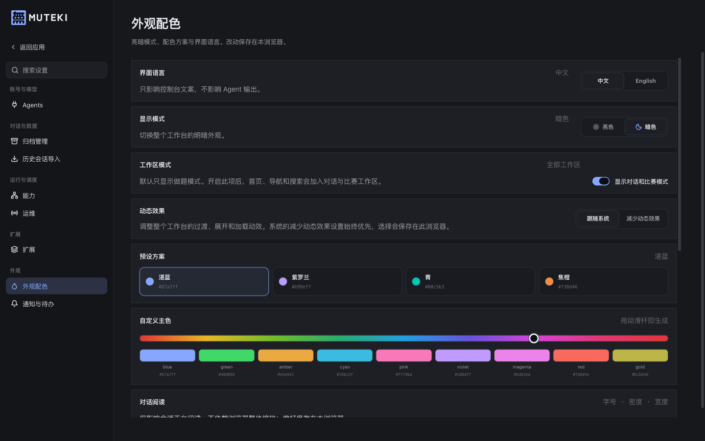
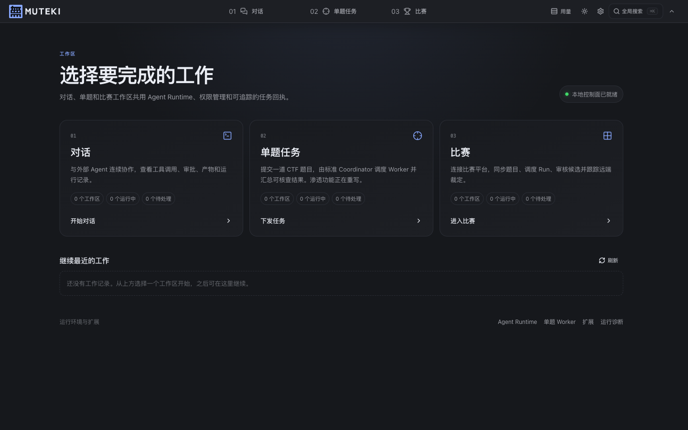
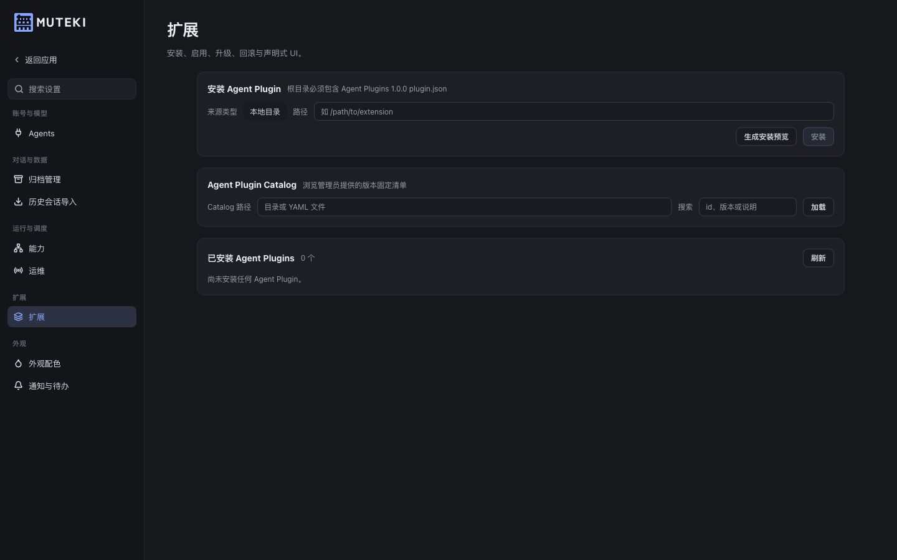

# 对话工作区、多 Agent 编排与扩展插件

> 返回：[简体中文 README](../README_CN.md) · [English README](../README.md) · 相关：[运行环境与 Worker 配置](runtime-and-configuration.md)

除安全专题工作区外，Muteki 正在演进为通用的开源 Coding Agent 控制平面。本文说明通用 **对话工作区**、**多 Agent 编排** 与 **自定义 Agent 插件** 的使用方式。

## 1. 工作区可见性（Web vs Desktop）

- **Desktop 桌面端**：原生左侧导航栏默认直接展示完整工作区（**对话、CTF 工作台、渗透测试、SRC 赏金、比赛**）。
- **Web 端**：默认首页只显示核心做题/渗透入口；如需使用 **对话**、**比赛** 与 **扩展** 入口，前往 **设置 → 外观配色 → 工作区模式**，开启 **显示对话和比赛模式**。

## 2. 对话工作区（`/chat`）

进入 **对话** 后，可以在统一控制面里与接入的 Coding Agent 进行多轮开发与工程协作：

- **接入配置**：先在 **设置 → Agents** 配置所需 Agent Runtime、凭据与权限策略。
- **执行可观测与可控**：完整展示模型思考过程、工具调用时间线、审批卡片、交互式终端、代码 Diff 审阅、产物导出以及上下文窗口与用量统计（`/usage`）。
- **内置页面预览**：Desktop 模式支持原生桌面浏览器面板，Web 模式支持带隔离代理的本地 iframe 预览；工作台内置工具也可直接打开和检查本机开发页面。
- **实时引导与排队**：支持消息排队、分支/回滚以及支持传输通道上的实时引导（具体按钮可用性以当前接入引擎为准）。
- **任务定时与共享**：支持定时任务提示及对话快照导出/分享。

## 3. 多模型 / 多 Agent 编排

在 **设置 → 多 Agent 编排**（以及 **设置 → 控制**）中，可以为主对话配置可委派的子 Agent 角色与执行权限：

- **角色绑定**：为不同子 Agent 角色固定 Provider、凭据、模型与推理等级；主 Agent 通过协作契约将子任务委派给托管子线程执行，并在协作面板汇总各子线程的真实运行状态与回传报告。
- **权限与审批策略**：统一控制新建托管子 Agent 的执行权限与审批模式（未显式配置时默认允许完全访问，可按需收紧为由主 Agent 或用户审批）；修改策略仅作用于新建子线程，不强行改写已在运行的线程。

## 4. 自定义 Agent Plugin（`/settings/extensions`）

进入 **设置 → 扩展**（或开启全部工作区后从首页“扩展”进入），可按 **Agent Plugins 1.0.0** 规范安装和管理扩展：

1. **指定来源**：支持本地目录、归档压缩包、Git 仓库、HTTP 地址或 Catalog 目录；扩展根目录须包含合法的 `plugin.json`。
2. **生成安装预览**：正式安装前先检查来源、摘要（Digest）和声明权限。
3. **生命周期管理**：已安装插件支持启用/停用、配置参数、升级、回滚与卸载。

> **安全提醒：** 仅安装你信任的扩展，安装前务必核对预览中的权限与摘要信息。
