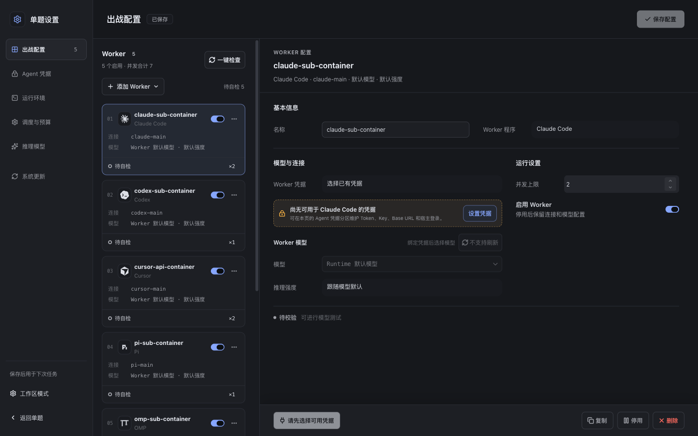
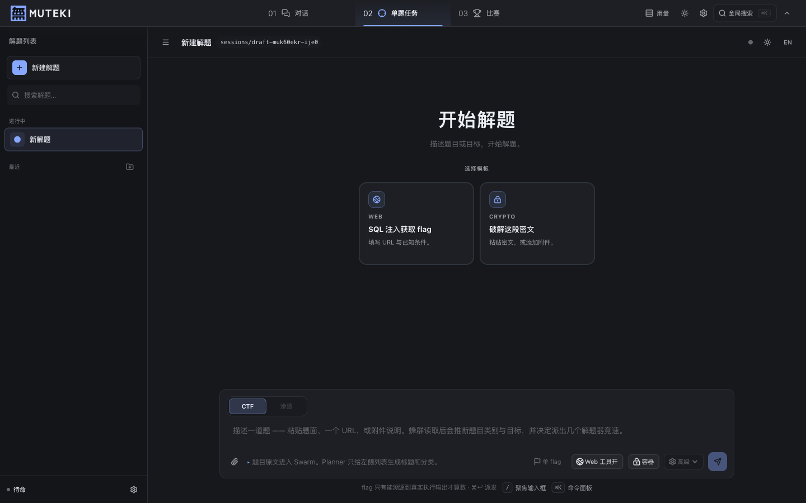
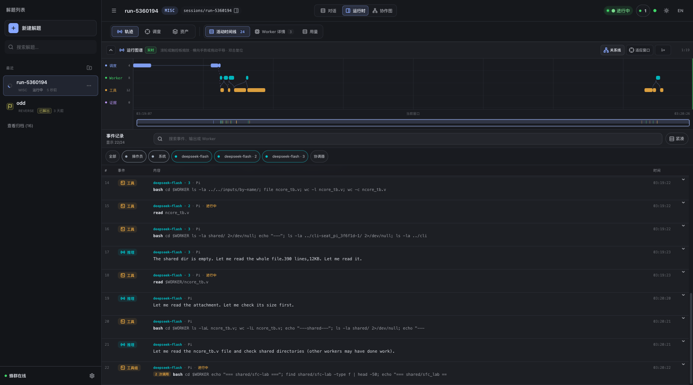
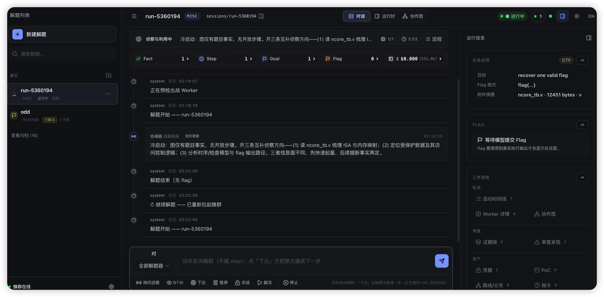

# CTF 与比赛工作台指南

> 返回：[简体中文 README](../README_CN.md) · [English README](../README.md) · 相关：[运行环境与 Worker 配置](runtime-and-configuration.md)

> **运行提醒：** 只对你拥有或获授权的题目与目标运行。Worker 可以执行命令并访问目标服务，Muteki 不承诺隔离恶意题目。完整条款见 [免责声明](../DISCLAIMER.md) 与 [SECURITY.md](../SECURITY.md)。

## 1. 启动前的最小配置

在派发第一道题之前，先进入 **CTF 工作台 → Worker 设置**（或 `/ctf/workers`）完成四项基础检查：

1. **Agent 凭据**：确认已有宿主机 CLI 登录可用，或新增 Token / API Key / 自定义 Base URL，并用“测试”按钮做真实连通测试。
2. **出战配置**：启用至少一名 Worker，为其绑定可用凭据与模型，执行自检确认通过。
3. **运行环境**：选择 **本地运行**（使用宿主机 CLI）或 **容器运行**（需要 Docker、Worker 镜像及可注入凭据）。
4. **推理模型**：为 **Planner** 绑定可用模型端点与模型并完成真实测试（Worker 与 Planner 需分别配置）。

详细参数与多节点配置见 [运行环境、Worker 配置与远程 Runner](runtime-and-configuration.md)。

## 2. 提交第一道题

进入 **CTF 工作台**（`/ctf`）：

- **题面**：提供题目名称、原文、目标 URL / 主机端口、已知事实与 Flag 格式；不要把未经验证的猜测写成既定事实。未指定分类时，系统会结合题面自动推断。
- **附件**：支持通过按钮、粘贴或拖拽上传题目文件；运行工作区会保留输入与 Worker 产物，方便复盘。
- **单 Flag / 多 Flag**：单 Flag 取得合格候选后可收敛结束；多 Flag 会持续收集，已知总数时建议填写预期数量，未填写时请结合预算或手动停止控制。
- **Web 工具**：可关闭 Agent 内置的 WebSearch / WebFetch，避免 Agent 检索外部内容导致目标偏移。关闭“搜索工具”会对 Claude、Codex 禁用搜索/抓取（Pi 本身无此工具），其余不支持禁用的引擎会拒绝启动。
- **高级选项**：按题目需要设置 Flag 正则/格式、是否允许 Worker 请求人工输入，以及本次运行的时长、Worker 总数与成本预算。

确认无误后点击 **派发蜂群**（macOS 快捷键 `⌘↵`）。首次运行需准备工作区与 Worker，请等待状态变化，不要反复点击派发。

## 3. 运行中：实时观察与人工干预

运行页（`/run/<id>`）汇总展示协调器消息、各 Worker 状态、工具调用时间线、共享证据与候选 Flag。输入框上方可指定目标为“全部解题器”或单个 Worker。

| 操作 | 作用 | 适用时机 |
| --- | --- | --- |
| **直接输入并回车 / 发送** | 向所选目标发送“提示”，**不新建 Step** | 补充线索、纠正题面、告知已验证结果 |
| **下达** | 将输入原文建成新 Step，触发新建 Worker 执行；正文中的 URL 可能更新目标 | 明确指定新方向或具体执行步骤 |
| **询问进展** | 汇总已确认结果、在研方向和阻塞项并回显到对话 | 想掌握现状且不打断当前调度 |
| **暂停 / 继续** | 暂停或恢复蜂群调度 | 临时人工排查或等待外部信息 |
| **冻结 / 解冻** | 立即冻结正在执行的 Worker，稍后再放行 | 需要即时强干预 |
| **停止** | 结束本次运行并停止 Worker，保留完整记录 | 目标已变、无需继续或达到人工判断上限 |

> **提示 vs 下达：** 例如输入“目录 `/admin` 已确认存在”，直接回车只会作为线索同步；点击 **下达** 会创建新的 Step 并可能拉起新 Worker。状态切换过程中请勿连续高频点击控制按钮。

如果 Worker 暂停并请求人工协助，可在待处理卡片中补充回答、提供资源，或标记拒绝/误报以继续推进。

## 4. 出现 Flag 或运行结束后

- **核验 Flag**：复制候选 Flag 到比赛或靶场平台验证。
- **标记误报**：若平台判错，在结果区点击 **标记误报**（或单行 Flag 旁的 `×`；多 Flag 先选定待否定条目）。系统会记录误报并重新打开解题。
- **继续做题**：在已结束页面沿用现有证据重新拉起蜂群继续探索。
- **追问 / 生成复盘**：结束后可向解题 Worker 追问细节，或生成完整复盘报告。报告会显示在对话中，并写入当前数据目录下的 `sessions/<run-id>/writeup.md`，同时可在 **CTF 报告**（`/ctf/reports`）统一查看。

## 5. 比赛工作区（`/competitions`）

Desktop 模式左侧栏默认包含 **比赛** 入口；Web 模式下若未看到，可在 **设置 → 外观配色 → 工作区模式** 开启全部工作区（见 [对话工作区与扩展插件](chat-and-extensions.md)）。

使用流程：

1. 建立并测试比赛平台连接（提供 **CTFd、rCTF、GZCTF** 连接选项，实际可用能力以连接探测结果为准）。
2. 登记远端比赛 ID 并同步题单。
3. 在比赛工作区内统一调度单题 Run、检查候选 Flag 并跟踪远端提交裁定。

> 涉及真实比赛账号与自动/远端提交前，建议先在测试比赛环境中验证完整流程。
