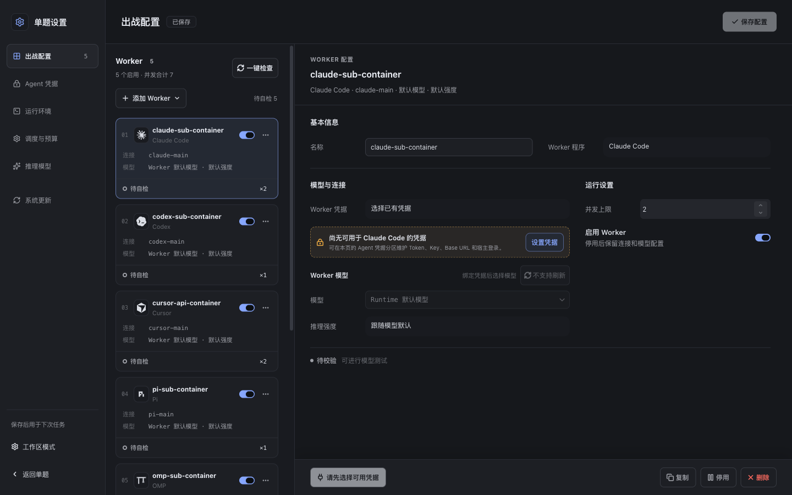

# 运行环境、Worker 配置与远程 Runner

> 返回：[简体中文 README](../README_CN.md) · [English README](../README.md) · 相关：[CHANGELOG](../CHANGELOG.md)

## 1. 首次启动后的最小配置

无论你使用 Desktop 还是 Web 模式，首次运行任务前先完成以下配置（CTF 入口在 `/ctf/workers`，通用对话在 `/settings/agents`）：

| 设置位置 | 控制内容 | 首次建议操作 |
| --- | --- | --- |
| **Worker 设置 → Agent 凭据** | 引擎探测、宿主登录、Token / Key、自定义端点与连接测试 | 确认至少一个凭据真实连通；不要把密钥写进题面或提交到 Git |
| **Worker 设置 → 出战配置** | Worker 阵容、引擎、模型、推理强度、启停与每席并发 | 先启用一名自检通过的 Worker，再逐步增加 |
| **Worker 设置 → 运行环境** | 本地 / 容器模式、容器作用域、网络、镜像及可选 VPN | 快速上手选“本地运行”；隔离或容器化选“容器运行” |
| **Worker 设置 → 调度与预算** | 自动调度 / 固定并跑、并发上限、总时长、Worker 数与成本上限 | 首次保持默认值，按资源需要调整 |
| **Worker 设置 → 推理模型** | Planner、Titler 的模型端点、模型与生成参数 | 至少完成一次 Planner 真实连通测试 |
| **设置 → 外观配色 → 工作区模式** | Web 端是否显示对话、比赛与扩展入口 | 需要试用全部工作区时开启 |

> **Worker 和 Planner 是两类独立配置：** Worker CLI 负责具体执行，Planner 负责任务拆分、调度决策与协调汇总。本地 Worker 可直接复用宿主机已有的 CLI 登录，Planner 则必须绑定可用的模型端点。保存设置仅作用于**下一次**任务，不会重建正在运行的任务。



## 2. 受支持的 Worker 引擎与本地模型

精选 Worker 注册表目前包含九类 CLI 引擎：**Claude Code、Codex、Cursor、Pi、OMP、Kimi、Grok、OpenCode、Droid**，容器默认安装版本以 [`docker/worker-common/engines.json`](../docker/worker-common/engines.json) 为准。列出或已安装 CLI 仍需配合有效凭据、可用模型和匹配的运行环境，才能通过自检。

### Pi + Ollama 本地模型配置示例

1. 在凭据/模型端点中添加兼容 OpenAI 的端点：
   - 宿主机本地 CLI：`http://127.0.0.1:11434/v1`
   - 本机 Docker 容器内：`http://host.docker.internal:11434/v1`
   - 远程 Runner 节点：填写该远程节点实际可达的地址（其 `localhost` 不是 Web 所在机器）
2. 选择 Ollama 实际提供的模型，并在对应运行环境中点击测试连通。
3. 将该端点/模型绑定到 **Pi** Worker，再单独为 **Planner** 绑定可用模型并保存配置。

> 页面提示“待自检”或“没有可用凭据”时，请先测试账号，再核对 Worker 的凭据、模型与运行环境绑定。自检会发起真实模型请求，可能产生少量调用费用。

### 模型价格估算

Muteki 使用公开的 [model-prices](https://github.com/jiayuqi7813/model-prices) 目录估算 Token 成本（缓存有效数据 24 小时），可在 **设置 → Agents 和接入点 → 模型价格** 调整映射与自定义单价（单位：USD / 百万 Token）。明确零价与未知价格独立区分，缺失用量不会伪造估算；公开标价不等同于实际账单。

## 3. 运行方式矩阵

| 运行方式 | 应用与 Worker 位置 | 说明 |
| --- | --- | --- |
| **macOS 本地** | Desktop 或 Web + 宿主机 CLI Worker | Apple Silicon 原生构建与真实模型流程已验证；CLI 与安全工具按需自行安装 |
| **macOS + Docker Desktop** | 本机应用 + Linux Worker 容器 | 共享 / 独立容器流程已验证；需准备 `muteki-worker` 镜像与可注入凭据 |
| **Linux Web / Compose** | Web + 独立 Runner（Docker） | 原生 Linux Web 包与双架构镜像均已发布；原生 `amd64` 实机模型验收持续补充中 |
| **Windows** | 通过 WSL2 或 Linux 主机部署 Web/Docker | 当前不提供原生 Windows 桌面包 |

### 本地运行 vs 容器运行

- **本地运行**：直接复用宿主机已安装并登录的 Agent CLI，上手最快。
- **容器运行**：不能自动继承宿主机登录，须在凭据页绑定可注入凭据，并准备 Worker 镜像：
  - 直接拉取官方精选镜像：`ghcr.io/fishcodetech/muteki-worker:v0.5.2`（`amd64` / `arm64`）
  - 或在仓库本地构建 `muteki-worker:latest`：`./docker/worker/build.sh`
  - 精选工具清单与可选重型扩展层（SageMath / angr / Volatility3）定义在 [`docker/worker/Dockerfile`](../docker/worker/Dockerfile) 与 [`docker/worker/Dockerfile.heavy`](../docker/worker/Dockerfile.heavy)。

### 共享容器池 vs 每 Run 独立容器

- **共享模式**：多个 Run 复用兼容的同一容器，各自维护工作区与进程生命周期，停止单个 Run 不影响邻居；但不构成不可信任务之间的操作系统级安全隔离。
- **独立模式**：每个 Run 独占一个容器，适合需要更强边界的任务。
- **并发调度**：执行节点会根据宿主资源推荐并发数，也支持手动指定或关闭调度上限（关闭不会取消已配置的 CPU/内存配额与任务预算）。超额任务会进入可见队列；暂停进程不等于立即释放内存。

## 4. 独立 Runner 与远程 Runner 节点

在 Docker Compose 或分布式部署中，**Web** 负责任务策略、前端与持久化记录，**Runner** 负责控制 Docker 与 Worker 进程（Compose 中仅 Runner 挂载 Docker socket）。各版本发布流水线验证范围见 [CHANGELOG.md](../CHANGELOG.md)。

### 接入远程 Runner 节点

前往 **设置 → CTF Worker → 执行节点**：

1. **开启远程节点监听**：填写监听地址（如 `0.0.0.0:7443`）与远程节点可达的公开地址（如 `https://203.0.113.10:7443`）并保存。首次开启会自动生成私有 CA 与服务端证书，并展示 CA 指纹及 `ca.pem` 下载。（若通过命令行 `--runner-tls-listen/--runner-tls-cert/--runner-tls-key` 启动，则页面只读。）
2. **签发一次性注册命令**：在“注册新节点”中填写名称与有效期（最长 15 分钟），生成包含一次性令牌与 CA 指纹的注册命令（仅显示一次，请勿写入共享 shell 历史）。
3. **在远程机器注册并启动**（需安装 Docker 与同版本 `muteki-server`）：

   ```bash
   printf '%s' '<token>' | muteki-server runner enroll --state-dir "$HOME/.muteki-runner" \
     --server https://203.0.113.10:7443 --ca-sha256 <fingerprint> --token-file /dev/stdin
   muteki-server runner --remote --state-dir "$HOME/.muteki-runner"
   ```

   如需经代理访问 Web，可设置 `HTTPS_PROXY=http://proxy:port`（仅支持 HTTP CONNECT 代理，`NO_PROXY` 生效），并用 `muteki-server runner status --state-dir ...` 查看节点身份与到期时间。
4. **节点运维**：节点上线后可在“运行环境”中选用（远程节点仅运行容器 Worker）。支持独立并发配置、排空（不再接新任务，在途任务继续）、恢复、凭据轮换（`runner install-credential`）、永久撤销（重注册须带 `--replace`）和删除。

## 5. 常见问题排查

| 现象 | 优先检查项 |
| --- | --- |
| 页面打不开 | 启动终端打印的 URL/端口、若启用了内置 HTTPS 则核对 `MUTEKI_WEB_TLS_CERT/KEY` 是否成对且路径有效、以及后端与前端报错输出 |
| 找不到可用 Worker | CLI 是否已安装并登录、Agent 凭据连通测试是否通过、Worker 是否启用并绑定有效模型 |
| 容器任务启动失败 | Docker 服务状态、Worker 镜像是否存在、是否绑定可注入容器凭据、网络/VPN 配置 |
| Planner 测试失败 | 模型端点、模型名、API Key / Base URL 与网络连通性（Worker 可用不代表 Planner 已配置） |
| Web 端看不到对话 / 比赛 / 扩展入口 | 在 **设置 → 外观配色 → 工作区模式** 中开启“显示对话和比赛模式” |
| Linux 原生 Web 包报错缺 `.so` 库 | 安装 C++ 运行库（如 Ubuntu 24.04：`sudo apt-get install libstdc++6`），可用 `ldd bin/muteki-server` 检查 |
| macOS 首次打开提示无法验证开发者 | 当前正式包已使用 Developer ID 签名但尚未公证，请在“系统设置 → 隐私与安全性”点击“仍要打开” |
| 候选 Flag 被平台判错 | 在结果区标记对应候选为误报以继续探索，同时核对题面和 Flag 格式 |
| 多 Flag 任务一直运行 | 检查是否填写预期 Flag 数量；未指定数量时请留意预算限制或手动停止 |
